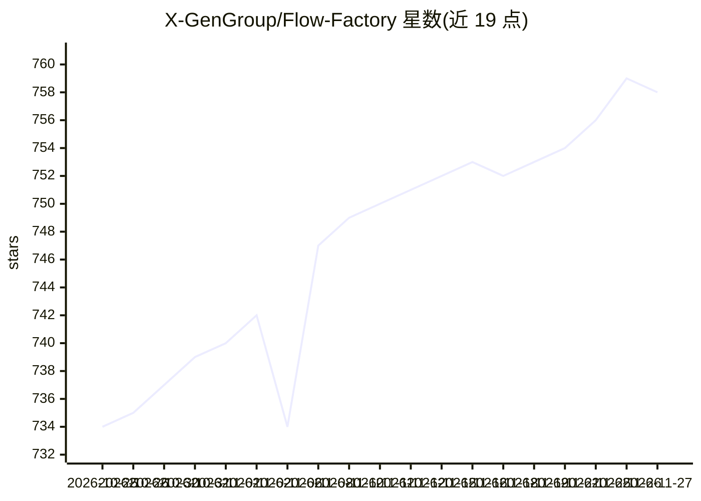

# X-GenGroup/Flow-Factory

⭐ 758 · Python · Apache-2.0 · 推送 2026-11-24 · [GitHub](https://github.com/X-GenGroup/Flow-Factory) · 组织维护

**扩散/流匹配模型统一微调与在线 RL 训练框架**

面向扩散与流匹配模型的统一微调框架，通过配置接口训练图像、图像编辑、视频及音视频联合模型。注册 19 个模型适配器与 18 个训练器（SFT、DPO、GRPO、ReFL、DRaFT-K、蒸馏等），支持全量权重与 LoRA，训练后端覆盖 DDP、DeepSpeed ZeRO-2 与 FSDP2，适配器声明 TP/SP/CP 并行路径；支持异步奖励、EMA 状态、断点续训与 wandb/swanlab/tensorboard 实验记录。需 Python 3.11+ 与 PyTorch 2.11+，提供 CUDA Docker 训练镜像。

## 筛选速览

| 维度 | 判定 | 备注 |
|---|---|---|
| AI 角色 | `ai-ecosystem` | LLM/agent 周边工具 |
| 许可风险 | `permissive` | Apache-2.0 |
| 部署形态 | `library` | 以包/库形式分发 |
| 模型依赖 | — | README 未给出锁定关系 |
| 硬件要求 | — | 无带数字的原话,不猜 |
| 安装摩擦 | `medium` | 含编译或系统依赖之一 |
| 成熟度 | — | 结构信号不足 |

## 能力要点

- 18 个注册训练器覆盖 SFT、DPO、GRPO、ReFL、DRaFT-K、蒸馏
- 19 个模型适配器声明 TP/SP/CP 并行路径，后端支持 FSDP2/DeepSpeed ZeRO-2
- 统一配置接口选择模型、目标、训练方法与 GPU 布局
- 提供 ff-train 与 ff-prompt-enhance 命令行工具及 CUDA Docker 镜像

## 适用场景

- 对 FLUX/Qwen-Image/Wan 等模型运行 GRPO + LoRA 在线强化学习微调
- 用 SFT 或离线 DPO 在自备演示/偏好数据集上训练
- 4/8 GPU 环境按 FSDP2×TP×CP 布局做并行训练

## 场景标签

`微调` `强化学习` · 领域:训练与推理

## 证据(README 行号)

> L5:  Unified Online RL and Offline Fine-Tuning for Diffusion and Flow-Matching Models
> L16: |Algorithm|18 registered trainers, including SFT, DPO, GRPO/Guard, DiffusionART, ReFL, DRaFT-K and DRTune|Algorithm
> L187: ```bash

## 星数曲线



2026-10-25 734 → 2026-11-27 758（+24）


---
*卡片 v1 · prompt 1.4 · 生成 2026-11-26 · 置信度 high · 依据 README sha `faad745d0888` · [字段定义](../../DATASET.md)*
