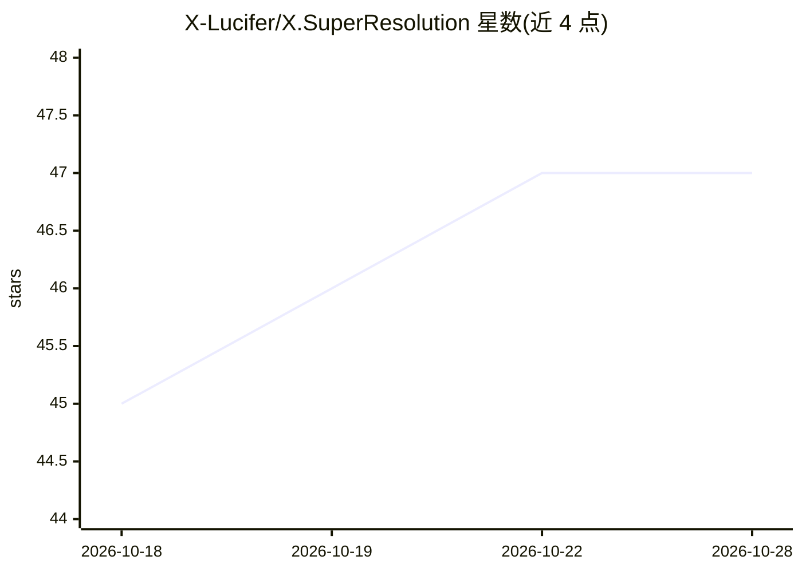

# X-Lucifer/X.SuperResolution

⭐ 47 · C# · 推送 2026-09-14 · [GitHub](https://github.com/X-Lucifer/X.SuperResolution) · 个人维护 · 中文 README

**本地离线图片超分辨率桌面工具，支持 Waifu2x/Real-ESRGAN/SRMD**

基于 Avalonia 与 NCNN-Vulkan 的 Windows 桌面图片处理工具，在本地完成放大、降噪与细节增强，无需联网。提供 Waifu2x、Real-ESRGAN、SRMD 三种引擎，支持引擎/模型/倍率/降噪参数选择、批量任务队列、PNG/JPG/WEBP 输出、GPU 设备与分块大小等性能配置，界面含亮暗主题与中英文语系。面向 Windows 10/11 x64，需支持 Vulkan 的 GPU；发行分完整包（含 .NET 运行时与模型）与精简包（需另装 .NET 10 与模型），也可用 .NET 10 SDK 从源码构建。声明不得用于商业及违法用途。

## 筛选速览

| 维度 | 判定 | 备注 |
|---|---|---|
| AI 角色 | `ai-native` | 本体是模型或模型工具 |
| 许可风险 | `none` | — |
| 部署形态 | `desktop` | 安装包/桌面程序 |
| 模型依赖 | — | README 未给出锁定关系 |
| 硬件要求 | — | 无带数字的原话,不猜 |
| 安装摩擦 | `medium` | 含编译或系统依赖之一 |
| 成熟度 | — | 结构信号不足 |

## 能力要点

- 三种引擎：Waifu2x、Real-ESRGAN、SRMD，可切换模型与降噪参数
- 批量任务队列，含进度、耗时与运行日志
- 本地离线处理，图片无需联网
- 完整包单 exe 合并托管程序集与原生引擎

## 适用场景

- 离线放大和降噪动漫或照片图片
- 批量处理多张图片并导出 PNG/JPG/WEBP
- 选择 GPU 设备与分块参数调节处理性能

## 场景标签

`图像视频处理` · 领域:感知与多模态

## 证据(README 行号)

> L3: 在本地完成图片放大、降噪与细节增强的桌面工具。基于 Avalonia 和 NCNN-Vulkan，提供 Waifu2x、Real-ESRGAN、SRMD 三种引擎，图片处理无需联网。
> L21: - **三种增强引擎**：切换 Waifu2x、Real-ESRGAN、SRMD，并选择对应模型、倍率和降噪参数。

## 星数曲线

2026-10-18 45 → 2026-10-28 47（+2）

---
*卡片 v1 · prompt 1.4 · 生成 2026-10-25 · 置信度 high · 依据 README sha `7f4afb864139` · [字段定义](../../DATASET.md)*
