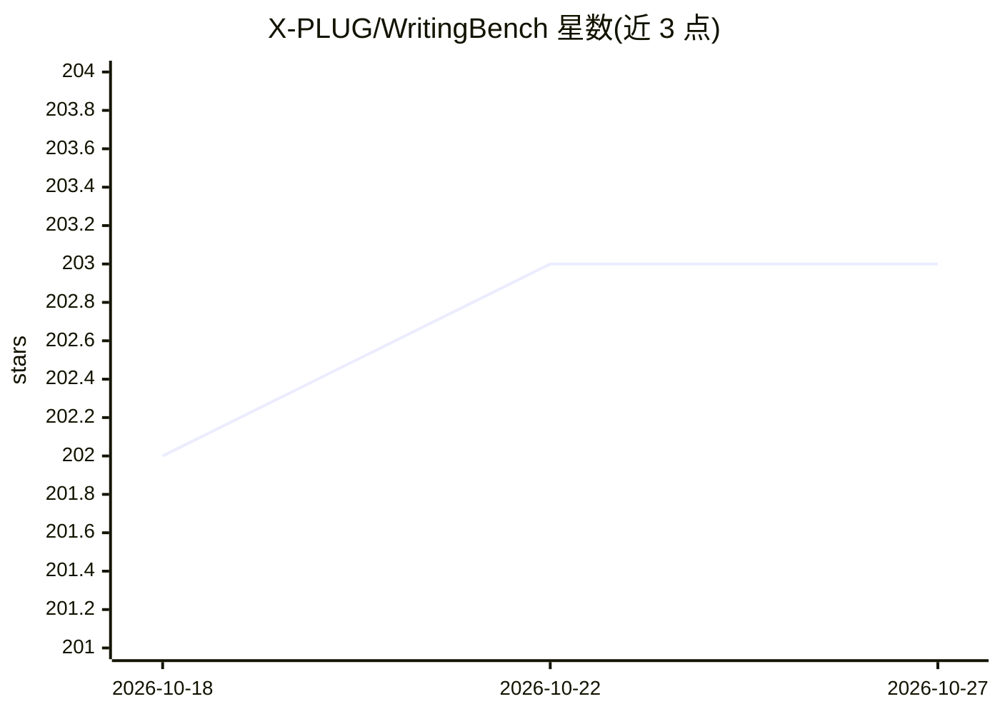

# X-PLUG/WritingBench

⭐ 203 · Python · Apache-2.0 · 推送 2025-12-19 · [GitHub](https://github.com/X-PLUG/WritingBench) · [官网](https://arxiv.org/pdf/2503.05244) · 组织维护 · 中文 README

**面向 LLM 生成写作能力的评测基准（1,000 条真实查询）**

评测 LLM 写作能力的基准数据集与评测框架：1,000 条真实查询覆盖 6 个主领域、100 个子领域，每条查询配有材料与 5 条实例专属评分标准。评测支持两种方式：LLM-as-a-Judge（当前推荐 Claude-Sonnet-4-5）与开源 critic 模型（Qwen-7B，本地路径加载）。仓库提供生成、评分、汇总三个脚本，并发布 Hugging Face 与 ModelScope 排行榜。构建流程结合模型增强查询生成与人工迭代精修（30 名标注员、5 名专家）。

## 筛选速览

| 维度 | 判定 | 备注 |
|---|---|---|
| AI 角色 | `ai-knowledge` | 知识聚合/清单类 |
| 许可风险 | `permissive` | Apache-2.0 |
| 部署形态 | `None` |  |
| 模型依赖 | — | README 未给出锁定关系 |
| 硬件要求 | — | 无带数字的原话,不猜 |
| 安装摩擦 | `low` | 无编译、无系统依赖或容器化 |
| 成熟度 | — | 结构信号不足 |

## 能力要点

- 1,000 条查询覆盖 6 主领域、100 子领域，每条配 5 条实例专属评分标准
- 支持 LLM-as-a-Judge 与微调 critic 模型两种评分路径
- 提供生成、评分、汇总的完整脚本与 Hugging Face/ModelScope 排行榜
- 构建流程含模型增强查询生成与人工迭代精修

## 适用场景

- 评测不同 LLM 在生成写作任务上的表现
- 在自有领域子集上运行评分并生成结果对比表
- 查找带材料约束的长文本写作测试查询

## 场景标签

`模型评测` · 领域:评测与运维

## 证据(README 行号)

> L31: WritingBench is a comprehensive benchmark for evaluating LLMs' writing capabilities across **1,000 real-world queri
> L36: WritingBench integrates diverse sources of materials. Each query is paired with **5 instance-specific criteria**, s

## 星数曲线

2026-10-18 202 → 2026-10-27 203（+1）

---
*卡片 v1 · prompt 1.4 · 生成 2026-10-22 · 置信度 high · 依据 README sha `3d1da0c872d0` · [字段定义](../../DATASET.md)*
