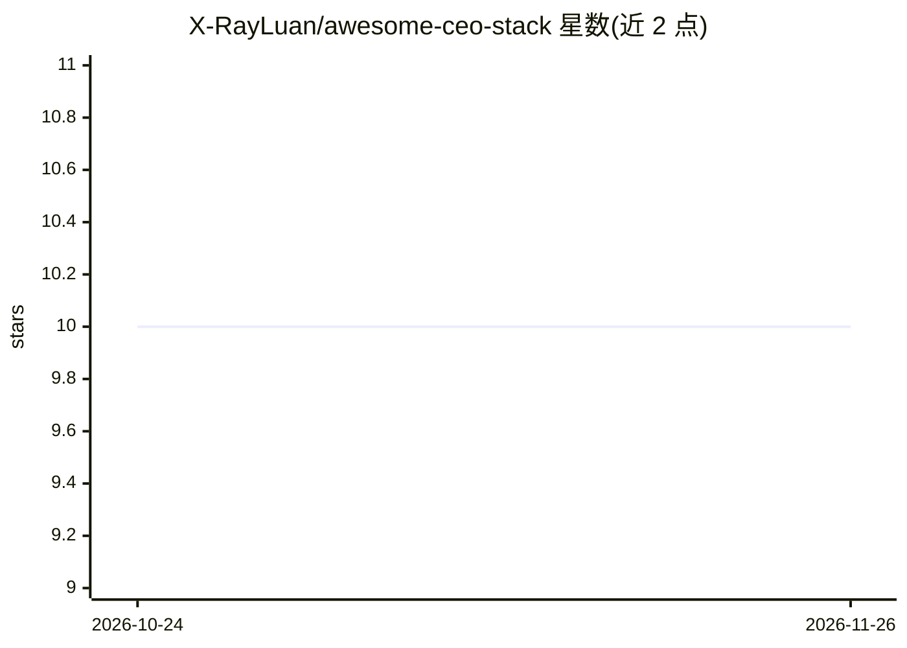

# X-RayLuan/awesome-ceo-stack

⭐ 10 · HTML · 推送 2026-07-08 · [GitHub](https://github.com/X-RayLuan/awesome-ceo-stack) · 个人维护 · 中文 README

**面向创始人/CEO 的 Claude/OpenClaw agent 技能合集**

以 Claude Skills / OpenClaw 技能形式组织的合集，每个技能是 ceo-skill/ 下含 SKILL.md、脚本与资源的独立文件夹，可单独装入 agent。覆盖产品宣传片（UI 截图→脚本→HTML 原型→B-roll→录屏→ffmpeg→TTS→飞书交付）、企业知识库、短视频、网页 PPT、提案 agent、K-12 家教、SEO 写作与股票研究等 8 个技能。通过 git clone 获取，复制技能目录到 agent 技能目录即可触发；部分技能需从环境变量读取 API key。

## 筛选速览

| 维度 | 判定 | 备注 |
|---|---|---|
| AI 角色 | `ai-knowledge` | 知识聚合/清单类 |
| 许可风险 | `none` | — |
| 部署形态 | `None` |  |
| 模型依赖 | — | README 未给出锁定关系 |
| 硬件要求 | — | 无带数字的原话,不猜 |
| 安装摩擦 | `medium` | 含编译或系统依赖之一 |
| 成熟度 | — | 结构信号不足 |

## 能力要点

- 8 个自包含技能文件夹，SKILL.md + scripts/ + references/
- 产品 UI 截图到 60 秒竖版宣传片的端到端本地流水线（含 Seedance i2v、ffmpeg、TTS）
- 兼容 Claude Code、Codex、OpenClaw，复制文件夹或打开 SKILL.md 即用
- 知识库技能生成 agent-ready 的 Markdown/Obsidian 结构并带可见性规则

## 适用场景

- 给产品快速产出宣传视频与投放短视频
- 把散落文档整理成 agent 可用的企业知识库
- 用 agent 生成投资人级别的演示文稿与提案
- 给孩子配置跨学科 K-12 学习辅导

## 场景标签

`精选清单` `金融量化` `知识库管理` · 领域:知识与检索

## 证据(README 行号)

> L20: **awesome-ceo-stack** is a batteries-included collection of **AI agent skills** (a.k.a. **Claude Skills** / OpenCla
> L5:  A curated stack of Claude / OpenClaw agent skills for founders &amp; CEOs.

## 星数曲线

2026-10-24 10 → 2026-11-26 10（+0）

---
*卡片 v1 · prompt 1.4 · 生成 2026-11-20 · 置信度 high · 依据 README sha `604af9372eee` · [字段定义](../../DATASET.md)*
