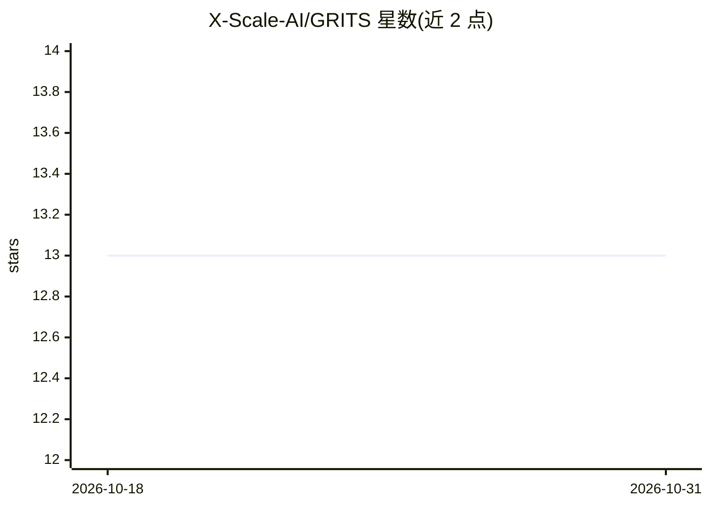

# X-Scale-AI/GRITS

⭐ 13 · NOASSERTION · 推送 2026-03-24 · [GitHub](https://github.com/X-Scale-AI/GRITS) · 组织维护

**AI agent 安全治理框架：21 项控制、评分与合规映射**

由 X Scale AI 维护的开源 AI 安全与治理标准：基于 DoD/DISA 零信任原则，提供 5 个支柱、5 层零信任模型下的 21 项控制目录，每项含显式 pass/fail 判定；配套加权评分方法、姿态分级徽章、生命周期治理模型与 NIST AI RMF / OWASP Top 10 合规交叉映射。面向企业 GRC 团队、CISO 与平台工程团队，仓库内含控制目录、评分方法、profile 模板等文档；另有 grits-agent-scanner 实现自动化扫描（本仓库外）。Apache 2.0 许可。

## 筛选速览

| 维度 | 判定 | 备注 |
|---|---|---|
| AI 角色 | `ai-ecosystem` | LLM/agent 周边工具 |
| 许可风险 | `none` | NOASSERTION |
| 部署形态 | `None` |  |
| 模型依赖 | — | README 未给出锁定关系 |
| 硬件要求 | — | 无带数字的原话,不猜 |
| 安装摩擦 | `low` | 无编译、无系统依赖或容器化 |
| 成熟度 | — | 结构信号不足 |

## 能力要点

- 21 项控制跨 5 层零信任模型（网络/操作者/应用/OS密钥/财务），每项含 pass/fail 判定
- 加权评分模型与 6 档姿态分级徽章，可嵌入仓库声明得分
- 合规映射覆盖 NIST AI RMF、NIST AI 600-1、OWASP LLM/Agentic Top 10
- GRITS Baseline 5 分钟即可完成 5 项关键控制检查，无需工具

## 适用场景

- 企业在部署 LLM 应用或 agent 前建立可审计的安全基线
- GRC 团队向审计方出示有据可查的 AI 治理记录与得分
- 安全团队按攻击面分层核查 agent 的暴露路径

## 场景标签

`网络安全` · 领域:学习与行业

## 证据(README 行号)

> L11: GRITS is the open standard for AI security and governance. It covers the full spectrum: LLM applications, RAG pipel
> L15: **Score and harden:** grits-agent-scanner -- the full scan-score-remediate implementation of this framework.
> L21: The framework is maintained by X Scale AI, a firm specializing in AI security architecture and enterprise AI govern

## 星数曲线

2026-10-18 13 → 2026-10-31 13（+0）

---
*卡片 v1 · prompt 1.4 · 生成 2026-10-31 · 置信度 high · 依据 README sha `98efe1b6457e` · [字段定义](../../DATASET.md)*
