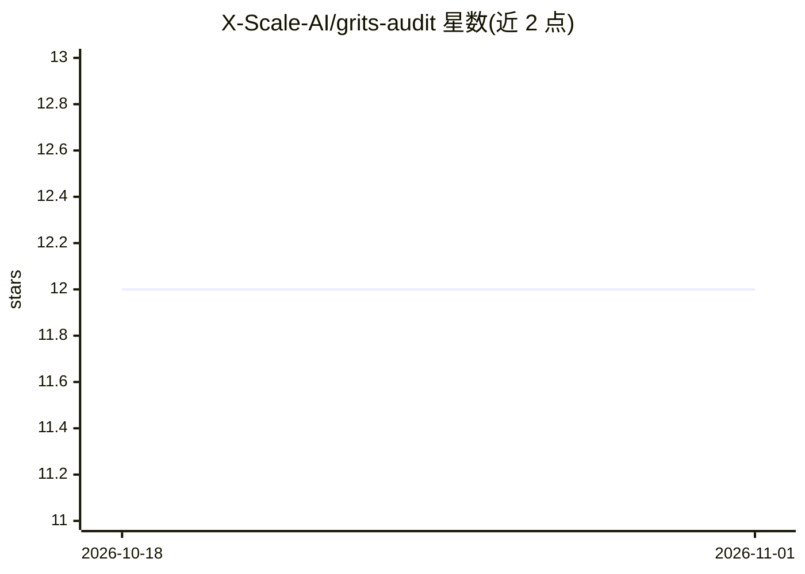

# X-Scale-AI/grits-audit

⭐ 12 · Python · Apache-2.0 · 推送 2026-03-23 · [GitHub](https://github.com/X-Scale-AI/grits-audit) · [官网](https://xscaleai.com) · 组织维护

**面向 OpenClaw/NemoClaw 代理的安全扫描与自动加固工具**

扫描 OpenClaw 与 NVIDIA NemoClaw AI 代理的运行时配置，按 5 层零信任模型（网络、操作者身份、插件沙箱、OS 与密钥、云成本）评分，并在改动前做完整快照、确认后自动修补，支持一条命令回滚。仅依赖 Python 3 标准库，git clone 后直接运行脚本。另支持无头模式接入 GitHub Actions/GitLab CI 等 CI/CD 流水线，输出 JSON/SARIF 合规报告并在边界降级时阻断构建。高级配置（网络分割、SIEM 集成等）由维护方 X Scale AI 提供咨询服务。

## 筛选速览

| 维度 | 判定 | 备注 |
|---|---|---|
| AI 角色 | `ai-ecosystem` | LLM/agent 周边工具 |
| 许可风险 | `permissive` | Apache-2.0 |
| 部署形态 | `None` |  |
| 模型依赖 | — | README 未给出锁定关系 |
| 硬件要求 | — | 无带数字的原话,不猜 |
| 安装摩擦 | `low` | 无编译、无系统依赖或容器化 |
| 成熟度 | — | 结构信号不足 |

## 能力要点

- 5 层零信任模型扫描与评分（网络/身份/插件/密钥/成本）
- 修补前完整快照与一条命令回滚
- 无外部依赖，仅 Python 3 标准库
- CI/CD 无头模式输出 JSON/SARIF 报告并阻断不安全部署

## 适用场景

- 部署前审计 AI 代理配置暴露的 API 密钥与网络边界
- 在 CI 流水线中持续检测配置漂移并阻断不安全合并
- 对已上线的 OpenClaw/NemoClaw 代理做自动加固

## 场景标签

`网络安全` · 领域:学习与行业

## 证据(README 行号)

> L12: **GRITS Audit** scans your agent's live configuration (OpenClaw and NVIDIA NemoClaw), scores your security posture 
> L29: Native tools like `openclaw security audit` act as smoke detectors -- they tell you there is a fire, but leave the 
> L53: GRITS isn't just a local developer tool; it is an automated gatekeeper designed to run headlessly in your CI/CD pip

## 星数曲线

2026-10-18 12 → 2026-11-01 12（+0）

---
*卡片 v1 · prompt 1.4 · 生成 2026-11-01 · 置信度 high · 依据 README sha `10bdc6c9bfbc` · [字段定义](../../DATASET.md)*
