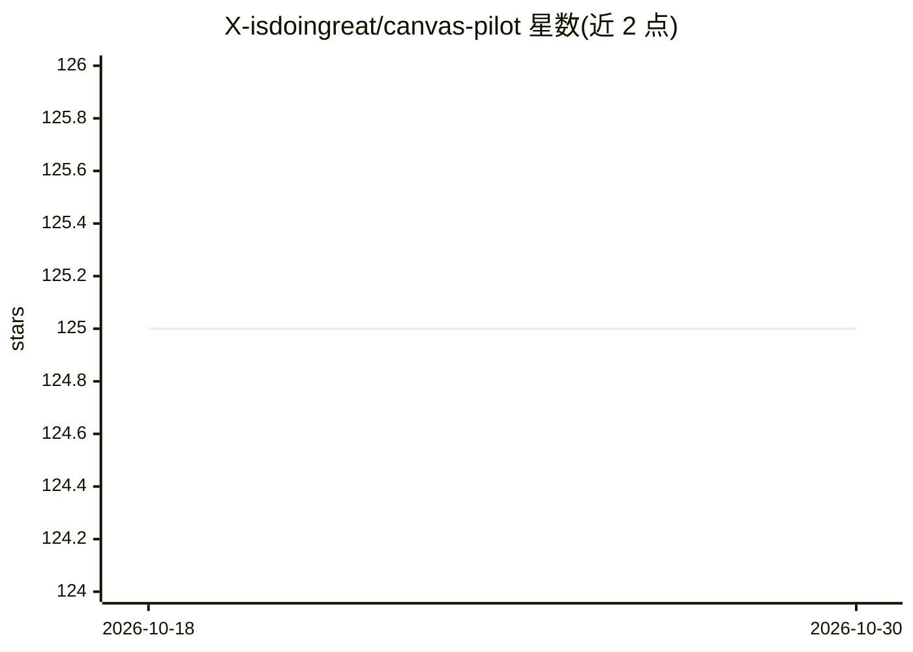

# X-isdoingreat/canvas-pilot

⭐ 125 · Python · AGPL-3.0 · 推送 2026-07-31 · [GitHub](https://github.com/X-isdoingreat/canvas-pilot) · [官网](https://canvas-pilot-rho.vercel.app/install) · 个人维护

**面向 Canvas LMS 学生的本地作业流程 AI 代理**

本地优先的 Canvas LMS AI 代理，运行于 Codex（Claude Code 路径保留为冻结历史）。它学习每门课程周期性作业的模式，通过 scan → approval → execute 边界生成待审草稿与运行报告；提交需要后续精确指令、本地结果验证与短期签名回执，cron 自动提交须显式授权。由一组 Codex 技能（setup、opportunity、bootstrap、scan、execute、submit、cron、skip）构成，课程差异写入本机 gitignore 的 overlay 文件。凭据、草稿与运行输出均留在本地。

## 筛选速览

| 维度 | 判定 | 备注 |
|---|---|---|
| AI 角色 | `ai-native` | 本体是模型或模型工具 |
| 许可风险 | `viral` | AGPL-3.0 |
| 部署形态 | `None` |  |
| 模型依赖 | — | README 未给出锁定关系 |
| 硬件要求 | — | 无带数字的原话,不猜 |
| 安装摩擦 | `low` | 无编译、无系统依赖或容器化 |
| 成熟度 | — | 结构信号不足 |

## 能力要点

- scan → approval → execute 审批边界，计划批准不授予 Canvas 写权限
- 按课程学习周期性作业模式，后续同技能运行非交互
- 提交需精确指令 + 本地结果验证 + Canvas 回读校验的签名回执
- 课程差异通过本机 overlay 文件隔离，凭据与输出留在本地

## 适用场景

- 每周用 scan canvas 汇总待办作业并生成待审草稿
- 重复结构课程（周题、阅读、测验）的批量起草
- 保留人工审核与提交决定权的前提下自动化作业编排

## 场景标签

`工作流自动化` · 领域:效率与自动化

## 证据(README 行号)

> L8: Canvas Pilot is an open-source, local-first Canvas LMS AI agent for Codex and
> L10: then reuses that pattern through scan -> approval -> execute workflows that
> L74: The default behavior is *produce verified drafts, you decide what to submit*.

## 星数曲线

2026-10-18 125 → 2026-10-30 125（+0）

---
*卡片 v1 · prompt 1.4 · 生成 2026-10-23 · 置信度 high · 依据 README sha `57fc69184715` · [字段定义](../../DATASET.md)*
