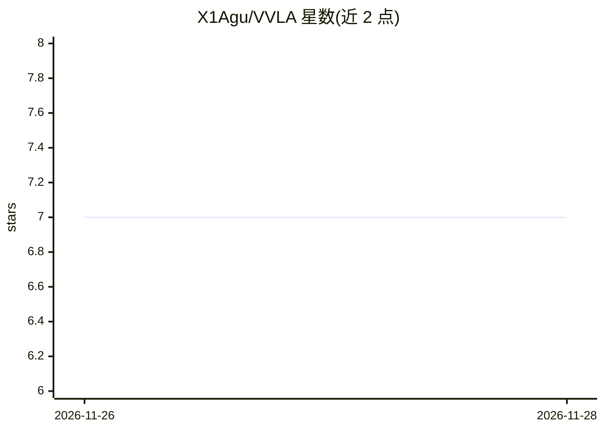

# X1Agu/VVLA

⭐ 7 · Python · Apache-2.0 · 推送 2026-11-23 · [GitHub](https://github.com/X1Agu/VVLA) · 个人维护

**单 GPU 高吞吐 VLA 模型推理与动态批处理引擎**

面向 π0.5、OpenVLA-OFT、LingBot-VLA2 三类视觉-语言-动作模型的推理与 serving 引擎，支持 RTX PRO 6000/A100/RTX 4090/RTX 3090。核心机制包括零填充动态批处理、分阶段 CUDA Graph 复用、免标定量化与跨 GPU 内存感知调度，通过二进制 IPC、HTTP 或 WebSocket 提供单客户端与多客户端服务。要求 Linux x86_64、Python 3.12、PyTorch 2.13.0（CUDA 13.0），从源码构建 wheel 安装。

## 筛选速览

| 维度 | 判定 | 备注 |
|---|---|---|
| AI 角色 | `ai-ecosystem` | LLM/agent 周边工具 |
| 许可风险 | `permissive` | Apache-2.0 |
| 部署形态 | `library` | 以包/库形式分发 |
| 模型依赖 | — | README 未给出锁定关系 |
| 硬件要求 | — | 无带数字的原话,不猜 |
| 安装摩擦 | `medium` | 含编译或系统依赖之一 |
| 成熟度 | — | 结构信号不足 |

## 能力要点

- 零填充动态批处理：精确 batch 宽度（1/2/4/8/16）、无占位计算，支持 IPC/HTTP/WebSocket
- 分阶段 CUDA Graph 复用：变长 VLM 前缀走 paged KV cache，静态 MoE 后缀图按宽度重放
- 3 行 Python API 与 vvla serve 单命令多客户端服务，进程隔离的 policy worker
- 内存感知跨 GPU 调度：在 24 GB 消费级卡上运行 6B MoE 模型

## 适用场景

- 单 GPU 同时驱动多台 20 Hz 机械臂的闭环控制
- 高并发仿真 rollout 的推理服务
- 在 24 GB 消费级显卡上运行原本 OOM 的 6B MoE VLA 模型

## 场景标签

`推理引擎` · 领域:训练与推理

## 证据(README 行号)

> L3: **VVLA is a high-throughput single-GPU inference and dynamic-batching engine for Vision-Language-Action models.**
> L12: **VVLA** is a comprehensive single-GPU inference and serving engine for **π0.5**, **OpenVLA-OFT**, and **LingBot-VL
> L31: - **3-line Python API**: `vvla.load("pi05", checkpoint=...).infer_batch([obs], [seed])`

## 星数曲线

2026-11-26 7 → 2026-11-28 7（+0）

---
*卡片 v1 · prompt 1.4 · 生成 2026-11-26 · 置信度 high · 依据 README sha `c3314f217beb` · [字段定义](../../DATASET.md)*
