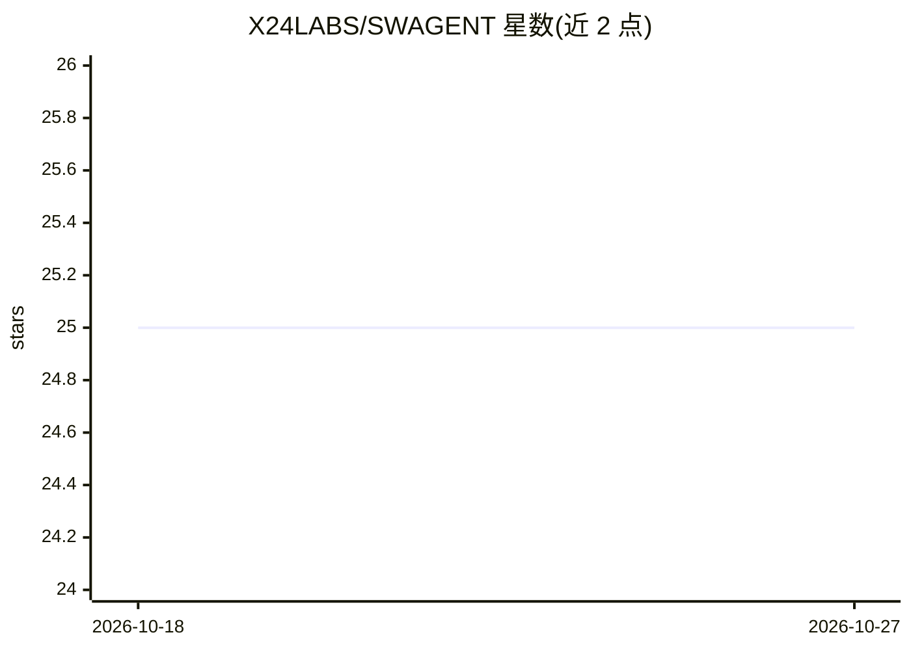

# X24LABS/SWAGENT

⭐ 25 · TypeScript · 推送 2026-07-27 · [GitHub](https://github.com/X24LABS/SWAGENT) · [官网](https://swagent.dev) · 组织维护

**面向 AI agent 的 API 文档生成器：一份 URL 服务人机两端**

读取 OpenAPI 规范，生成三种输出：供 LLM agent 的 token 优化版 llms.txt（压缩记法，自称约比原始 JSON 小 75%）、供开发者的完整 markdown 参考文档、以及零依赖语义 HTML 落地页。通过标准 HTTP 内容协商，同一基础 URL 按 Accept 头返回 HTML 或 markdown。以 npm 包提供 7 个框架适配器（Fastify/Express/Hono/Elysia/Koa/h3/NestJS）及 CLI，支持共享访问令牌保护私有文档、ETag 缓存与生成失败回退。CLI 生成的是静态文件，无法执行鉴权。

## 筛选速览

| 维度 | 判定 | 备注 |
|---|---|---|
| AI 角色 | `ai-ecosystem` | LLM/agent 周边工具 |
| 许可风险 | `permissive` | — |
| 部署形态 | `library` | 以包/库形式分发 |
| 模型依赖 | — | README 未给出锁定关系 |
| 硬件要求 | — | 无带数字的原话,不猜 |
| 安装摩擦 | `low` | 无编译、无系统依赖或容器化 |
| 成熟度 | — | 结构信号不足 |

## 能力要点

- 同一 URL 依据 Accept 头做内容协商，agent 无需发现 /llms.txt
- OpenAPI 转 llms.txt/to-humans.md/index.html 三种输出
- 7 个框架适配器（Fastify/Express/Hono/Elysia/Koa/h3/NestJS）+ CLI
- 共享令牌鉴权（查询参数/Bearer/Cookie，常数时间比较）

## 适用场景

- 让自己的 API 文档同时可被 LLM agent 与人类读取
- 降低 agent 阅读 API 文档的 token 消耗
- 为内部/私有 API 文档加访问令牌保护

## 场景标签

 · 领域:API 文档/开发者工具

## 证据(README 行号)

> L10:  Token-optimized <code>llms.txt</code> for AI agents, full markdown for developers, semantic HTML for browsers.
> L22: LLM agents don't need to discover `/llms.txt`. The base URL serves the right format automatically:

## 星数曲线

2026-10-18 25 → 2026-10-27 25（+0）

---
*卡片 v1 · prompt 1.4 · 生成 2026-10-27 · 置信度 high · 依据 README sha `d92b20972a52` · [字段定义](../../DATASET.md)*
