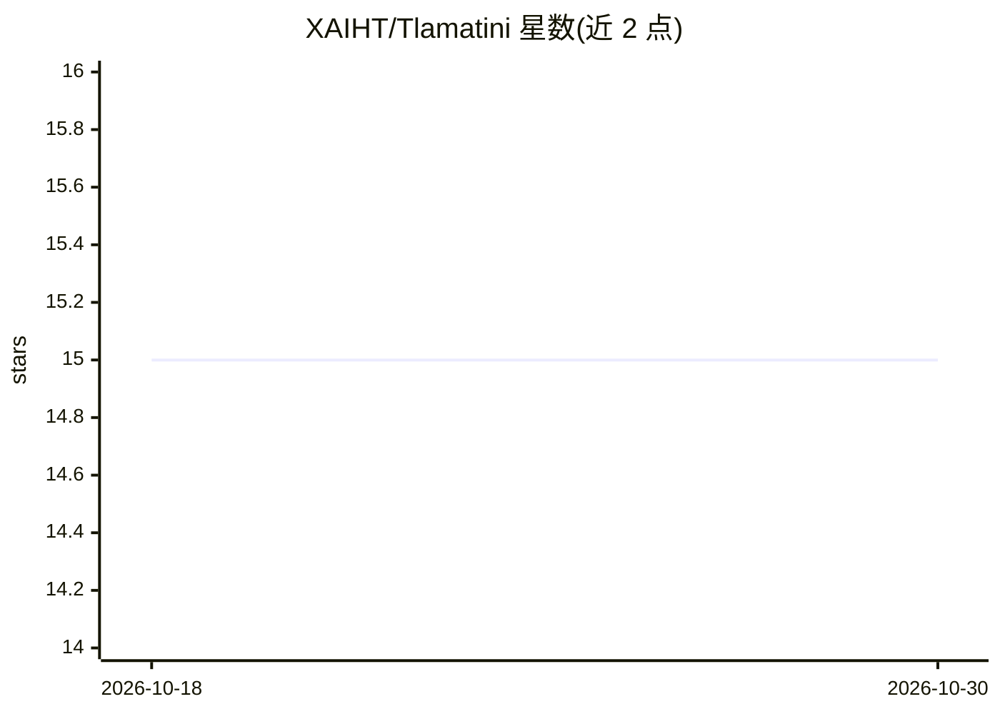

# XAIHT/Tlamatini

⭐ 15 · Python · MIT · 推送 2026-10-27 · [GitHub](https://github.com/XAIHT/Tlamatini) · [官网](https://xaiht.org) · 个人维护

**Windows 本地优先的 AI 开发与自动化工作台，覆盖代码/3D/硬件**

面向 Windows 10/11 的本地优先 AI 开发与自动化环境（MIT 开源，v1.91.1）：提供语音输入、可编辑画布与实时教学（Interactor）、真实终端命令执行（Terminater）、86 个可视化工作流代理与 110 个内置工具，集成 Unreal Engine、Blender MCP、STM32/ESP32/Arduino/ESPHome 硬件、FAISS+BM25 混合检索与外部 MCP 客户端（最多五个服务器）。本地运行控制配合云端推理；README 声明完整体验需另行购买 Ollama Pro 订阅，各外部集成需自备对应工具链与硬件。

## 筛选速览

| 维度 | 判定 | 备注 |
|---|---|---|
| AI 角色 | `ai-native` | 本体是模型或模型工具 |
| 许可风险 | `permissive` | MIT |
| 部署形态 | `desktop` | 安装包/桌面程序 |
| 模型依赖 | local-ok | 支持本地模型 |
| 硬件要求 | — | 无带数字的原话,不猜 |
| 安装摩擦 | `low` | 无编译、无系统依赖或容器化 |
| 成熟度 | — | 结构信号不足 |

## 能力要点

- 86 个工作流代理（67 个可从聊天调用）与 110 个内置工具
- Interactor 实时编辑器教学与 Terminater 逐键终端执行
- Unreal/Blender/STM32/ESP32/Arduino/ESPHome 集成
- 外部 MCP 客户端支持 stdio/HTTP/SSE/WebSocket，最多五个服务器

## 适用场景

- 通过对话与可视化工作流编写代码、操作项目与 Git
- 在聊天中操作 Unreal、Blender 场景与嵌入式硬件烧录
- 用语音输入想法并让代理在真实终端中执行命令

## 场景标签

`Agent 框架` `多智能体` `工作流自动化` `编码 Agent` · 领域:Agent 开发

## 证据(README 行号)

> L6:  Tlamatini is a local-first AI development and automation environment for Windows.
> L23:  86 workflow agents &nbsp;·&nbsp; 67 agents callable from chat &nbsp;·&nbsp; 110 built-in tools

## 星数曲线

2026-10-18 15 → 2026-10-30 15（+0）

---
*卡片 v1 · prompt 1.4 · 生成 2026-10-30 · 置信度 mid · 依据 README sha `2c88b50b2931` · [字段定义](../../DATASET.md)*
