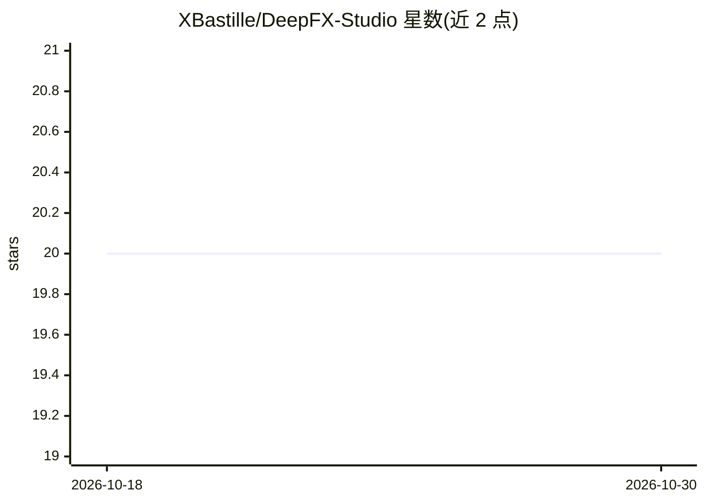

# XBastille/DeepFX-Studio

⭐ 20 · Python · 推送 2026-01-04 · [GitHub](https://github.com/XBastille/DeepFX-Studio) · 组织维护

**多模型图像处理 Web 平台：上色/超分/抠图/修复等七类 AI 工具**

基于 PyTorch Lightning 与 Django 的图像处理平台，复现并部署多项计算机视觉研究：DeOldify 老照片上色、Real-ESRGAN 超分辨率、U²-Net 显著目标检测抠图、FLUX/SAM+LaMa 图像修复、AnimeGAN 照片动漫化、Gatys 风格迁移、Stable Diffusion 3.5 文生图。部分功能（Flux Inpainting、文生图）通过 HuggingFace pipeline/API 调用实现，本地管线支持 512×512，Flux 走推理端点支持 1024×1024。训练在 Lightning.ai A100 上完成，提供 Azure 部署与 NVIDIA Docker 容器化支持。README 未给出具体安装命令。

## 筛选速览

| 维度 | 判定 | 备注 |
|---|---|---|
| AI 角色 | `ai-native` | 本体是模型或模型工具 |
| 许可风险 | `none` | — |
| 部署形态 | `None` |  |
| 模型依赖 | — | README 未给出锁定关系 |
| 硬件要求 | — | 无带数字的原话,不猜 |
| 安装摩擦 | `medium` | 含编译或系统依赖之一 |
| 成熟度 | — | 结构信号不足 |

## 能力要点

- 七类 AI 图像功能模块（上色/超分/抠图/修复/动漫化/风格迁移/文生图）
- 复现 DeOldify、Real-ESRGAN、U²-Net、AnimeGAN 等论文实现
- 文生图与图像修复集成 HuggingFace Diffusers/Transformers（SD 3.5、FLUX.1-dev）
- Django Web 界面含用户认证，支持 NVIDIA Docker 与 Azure 部署

## 适用场景

- 在网页端一站式处理老照片上色与图像超分
- 电商或设计场景批量抠图去背景
- 输入文字提示词生成图像，再叠加修复与风格化效果

## 场景标签

`图像视频处理` `图像生成` · 领域:内容生成

## 证据(README 行号)

> L25:  DeepFX Studio represents a comprehensive platform that bridges cutting-edge computer vision research with practica
> L61: - **Paper**: "Real-ESRGAN: Training Real-World Blind Super-Resolution with Pure Synthetic Data" (ICCVW 2021)
> L104: - **Model**: "black-forest-labs/FLUX.1-dev" with ControlNet inpainting
> L171: - **Primary Model**: Stable Diffusion 3.5 Large via HuggingFace Diffusers

## 星数曲线

2026-10-18 20 → 2026-10-30 20（+0）

---
*卡片 v1 · prompt 1.4 · 生成 2026-10-28 · 置信度 high · 依据 README sha `28874f2c9b2a` · [字段定义](../../DATASET.md)*
