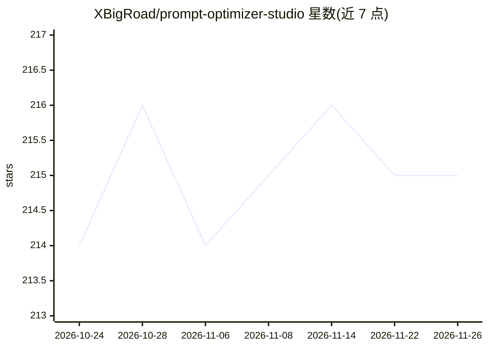

# XBigRoad/prompt-optimizer-studio

⭐ 215 · TypeScript · AGPL-3.0 · 推送 2026-11-10 · [GitHub](https://github.com/XBigRoad/prompt-optimizer-studio) · [官网](https://github.com/XBigRoad/prompt-optimizer-studio/blob/main/docs/deployment/docker-self-hosted.md) · 个人维护 · 中文 README

**提示词优化工作台：多轮自动优化评分，支持人工接管**

自托管 Web 服务（AGPL-3.0），把一版 prompt 经多轮自动流水线优化为可直接交付的完整成品：每轮同时复核当前稿并生成下一稿，评分采用任务级/全局 rubric，同一候选需连续多次可信通过才判定完成。用户可中途暂停、补充下一轮引导、修改长期规则与评分标准。支持源码构建与官方 GHCR Docker 镜像部署，数据存 SQLite，通过配置台填写 Base URL 与 API Key 接入多家服务商。

## 筛选速览

| 维度 | 判定 | 备注 |
|---|---|---|
| AI 角色 | `ai-native` | 本体是模型或模型工具 |
| 许可风险 | `viral` | AGPL-3.0 |
| 部署形态 | `self-host` | docker 或自建部署 |
| 模型依赖 | locked-api |  |
| 硬件要求 | — | 无带数字的原话,不猜 |
| 安装摩擦 | `low` | 无编译、无系统依赖或容器化 |
| 成熟度 | — | 结构信号不足 |

## 能力要点

- 多轮自动优化流水线：复核当前稿+生成下一稿，连续可信通过才算完成
- 人工接管机制：暂停、下一轮引导、长期规则、任务级 rubric 覆写
- 支持 OpenAI-compatible、Anthropic、Gemini、Mistral、Cohere 五种接口协议
- 源码构建与官方 GHCR Docker 镜像两种部署方式，SQLite 存储可自定义路径

## 适用场景

- 把手头一版 prompt 打磨成可直接交付的完整成品
- 接入自己的模型服务商做多轮提示词优化
- 需要人工把控方向的半自动化提示词迭代

## 场景标签

`提示工程` · 领域:Agent 开发

## 证据(README 行号)

> L12: 把一版 prompt 自动优化成高质量可直接交付的完整成品，而且中途随时能接管。
> L255:  - 产出的是一份可以直接复制使用的完整提示词，它来自自动化多轮优化流水线。

## 星数曲线

2026-10-24 214 → 2026-11-26 215（+1）

---
*卡片 v1 · prompt 1.4 · 生成 2026-11-25 · 置信度 high · 依据 README sha `fe6283c3e1de` · [字段定义](../../DATASET.md)*
