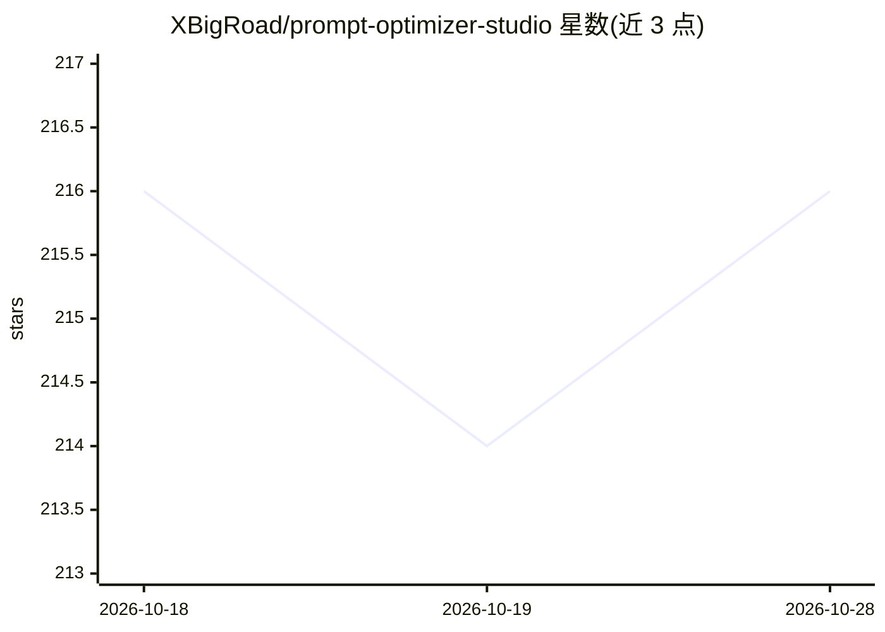

# XBigRoad/prompt-optimizer-studio

⭐ 216 · TypeScript · AGPL-3.0 · 推送 2026-04-04 · [GitHub](https://github.com/XBigRoad/prompt-optimizer-studio) · [官网](https://github.com/XBigRoad/prompt-optimizer-studio/blob/main/docs/deployment/docker-self-hosted.md) · 个人维护 · 中文 README

**自托管的提示词多轮自动优化工作台**

Prompt Optimizer Studio 以自托管服务端版发布：用户提交初版 prompt，系统循环执行“复核当前稿 + 生成下一稿”，同一候选需连续多次可信通过（默认 3 次）且无 material issues/drift 才标记完成，最终产出可复制使用的完整提示词。过程中可随时暂停、补充下一轮引导、编辑长期规则与任务级 rubric。支持 OpenAI-compatible、Anthropic、Gemini、Mistral、Cohere 协议，并为 DeepSeek/Kimi/Qwen/GLM/OpenRouter 提供预设入口。提供源码构建、GHCR 官方镜像与 npm 本地开发三种运行方式，数据存于服务端 SQLite。

## 筛选速览

| 维度 | 判定 | 备注 |
|---|---|---|
| AI 角色 | `ai-ecosystem` | LLM/agent 周边工具 |
| 许可风险 | `viral` | AGPL-3.0 |
| 部署形态 | `self-host` | docker 或自建部署 |
| 模型依赖 | locked-api |  |
| 硬件要求 | — | 无带数字的原话,不猜 |
| 安装摩擦 | `low` | 无编译、无系统依赖或容器化 |
| 成熟度 | — | 结构信号不足 |

## 能力要点

- 多轮自动优化流水线：复核与生成并行，连续可信通过才完成
- 人工接管入口：暂停、下一轮引导、长期规则、任务级 rubric 覆写
- 支持 5 种 API 协议与多个国内外 provider 预设
- Docker 自托管，数据保存在服务端 SQLite（AGPL-3.0-only）

## 适用场景

- 把不能直接交付的初版 prompt 自动打磨成可交付成品
- 在自托管环境里接自己的 provider 与模型跑优化任务
- 优化中途人工干预、调整评分规则后继续运行

## 场景标签

`提示工程` · 领域:Agent 开发

## 证据(README 行号)

> L12: 把一版 prompt 自动优化成高质量可直接交付的完整成品，而且中途随时能接管。
> L96: |`1. 提交初稿`|先给系统一版 prompt，任务从这里开始|
> L231: 当前仓库发布的是 **Self-Hosted / Server Edition（自托管服务端版）**。

## 星数曲线

2026-10-18 216 → 2026-10-28 216（+0）

---
*卡片 v1 · prompt 1.4 · 生成 2026-10-22 · 置信度 high · 依据 README sha `7b346ab70110` · [字段定义](../../DATASET.md)*
