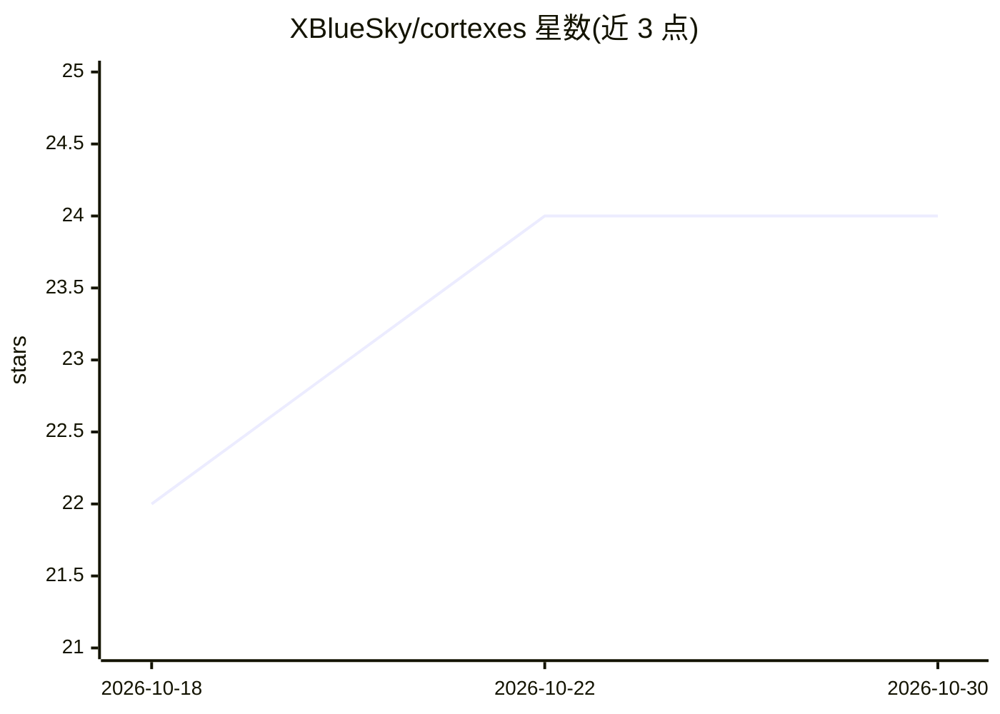

# XBlueSky/cortexes

⭐ 24 · Python · Apache-2.0 · 推送 2026-10-21 · [GitHub](https://github.com/XBlueSky/cortexes) · [官网](https://cortexes.pages.dev) · 个人维护 · 中文 README

**Claude Code 个人知识库插件：会话记录、记忆蒸馏与混合检索**

面向 Claude Code 用户的个人知识库插件：会话结束时经 TOML 过滤管道自动写入记录（Raw/），可蒸馏为笔记与项目知识；提供 BM25+向量双流 RRF 融合检索（ChromaDB + OpenAI text-embedding-3-small，jieba 中文分词），无 OPENAI_API_KEY 时自动降级为纯 BM25 本地检索。配套 cortex-vec CLI（PyPI 发布）负责索引与蒸馏导航，蒸馏过程按预算分页读取避免上下文溢出。仓库为纯 markdown+git 的 vault 结构，向量索引仅作可重建的派生索引。

## 筛选速览

| 维度 | 判定 | 备注 |
|---|---|---|
| AI 角色 | `ai-ecosystem` | LLM/agent 周边工具 |
| 许可风险 | `permissive` | Apache-2.0 |
| 部署形态 | `library` | 以包/库形式分发 |
| 模型依赖 | — | README 未给出锁定关系 |
| 硬件要求 | — | 无带数字的原话,不猜 |
| 安装摩擦 | `low` | 无编译、无系统依赖或容器化 |
| 成熟度 | — | 结构信号不足 |

## 能力要点

- SessionEnd 钩子经 TOML 过滤管道自动记录会话（>4KB）
- BM25+向量 RRF 融合检索，jieba 支持中英混合查询
- 无 API key 时降级为纯本地 BM25 检索
- 蒸馏命令按预算/覆盖计划分页读取原始记录，不整载入上下文

## 适用场景

- 我想在 Claude Code 会话间保留和检索工作记忆
- 把长会话记录蒸馏成可检索的技术笔记
- 会话开始时自动注入与当前仓库相关的记忆

## 场景标签

`Agent 记忆` `知识库管理` `RAG` · 领域:Agent 开发

## 证据(README 行号)

> L5:  A personal knowledge vault plugin for Claude Code — session recording, memory distillation, semantic retrieval.
> L22: - **Semantic search** — OpenAI embeddings + ChromaDB, with mixed Chinese/English
> L151: |`/cortexes:query`|Search the vault — semantic (`cortex-vec`) with grep and BM25 fallbacks. Running it counts as a

## 星数曲线

2026-10-18 22 → 2026-10-30 24（+2）

---
*卡片 v1 · prompt 1.4 · 生成 2026-10-27 · 置信度 high · 依据 README sha `1a243259ef75` · [字段定义](../../DATASET.md)*
