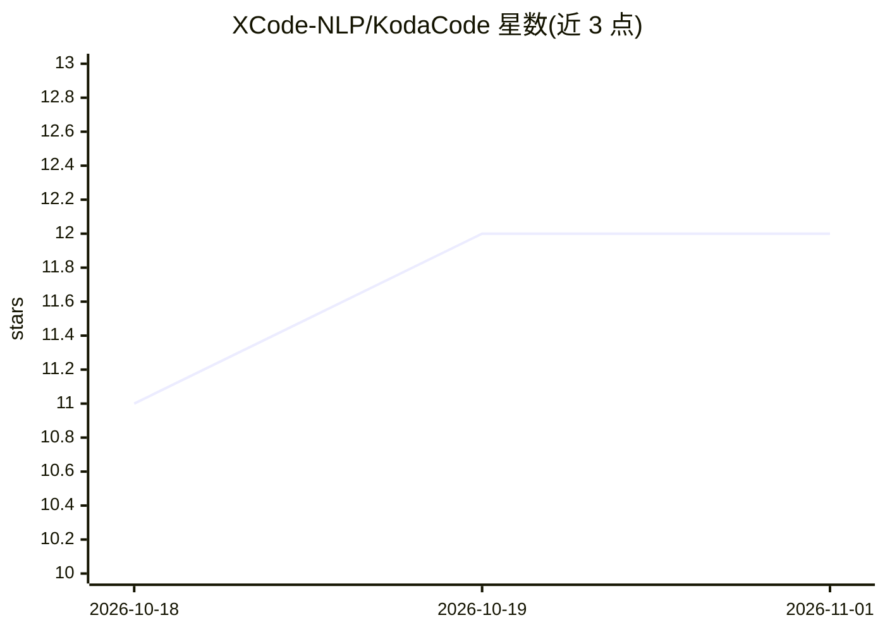

# XCode-NLP/KodaCode

⭐ 12 · 推送 2026-08-25 · [GitHub](https://github.com/XCode-NLP/KodaCode) · [官网](https://kodacode.ru/) · 组织维护

**KodaCode（AI 编程助手）的官方错误与功能建议追踪仓库**

这不是产品代码仓库，而是 KodaCode 的用户反馈收集处：用户通过 Issue 模板提交错误报告（含复现步骤、环境信息）与新功能请求，开发团队在此跟踪任务状态与标签，并在可能的绕行方案发布于此。README 指向官方网站、JetBrains/VSCode/CLI 版本下载入口与 Telegram 社区。仓库本身不包含产品安装或运行说明。

## 筛选速览

| 维度 | 判定 | 备注 |
|---|---|---|
| AI 角色 | `ai-ecosystem` | LLM/agent 周边工具 |
| 许可风险 | `none` | — |
| 部署形态 | `None` |  |
| 模型依赖 | — | README 未给出锁定关系 |
| 硬件要求 | — | 无带数字的原话,不猜 |
| 安装摩擦 | `low` | 无编译、无系统依赖或容器化 |
| 成熟度 | — | 结构信号不足 |

## 能力要点

- 错误报告与新功能请求的双模板 Issue 流程
- 开发团队在 Issue 中维护任务状态、标签与绕行方案
- 提供 JetBrains、VSCode、CLI 三端下载入口（外链）

## 适用场景

- 遇到 Koda 缺陷时按模板提交可复现的错误报告
- 为 Koda 提交新功能建议并投票支持已有建议
- 查看官方对已知问题的状态与绕行方案

## 场景标签

 · 领域:开发工具/社区支持

## 证据(README 行号)

> L5: Этот репозиторий предназначен для сбора сообщений об ошибках и предложений по развитию от пользователей Koda.
> L8: * Скачать Koda для JetBrains, VSCode или CLI: <https://download.kodacode.ru>

## 星数曲线

2026-10-18 11 → 2026-11-01 12（+1）

---
*卡片 v1 · prompt 1.4 · 生成 2026-11-01 · 置信度 mid · 依据 README sha `1b252c39ad8d` · [字段定义](../../DATASET.md)*
