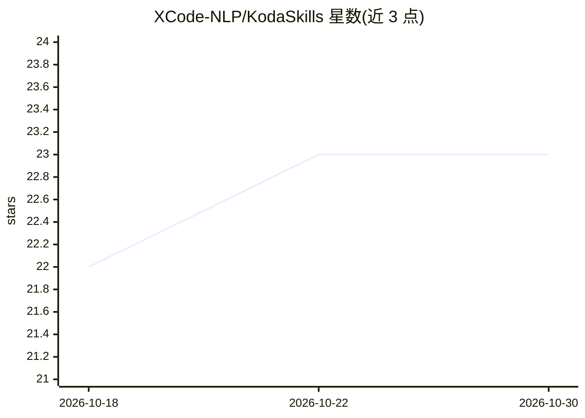

# XCode-NLP/KodaSkills

⭐ 23 · Python · MIT · 推送 2026-10-16 · [GitHub](https://github.com/XCode-NLP/KodaSkills) · [官网](https://kodacode.ru) · 组织维护

**KodaCode AI 助手的 agent 技能（SKILL.md）集合**

面向 AI 编程助手 Koda 的技能仓库：每个技能是一个含 YAML frontmatter 元数据（name/description）的 SKILL.md 指令集，模型在任务匹配时加载对应指令。支持 Koda 插件（VSCode/JetBrains，v0.7.0 起）与 koda-cli（v0.3.0 起），可全局或按项目安装，通过 npx skills add 交互式安装，或在面板/CLI 中启用。仓库由 GitHub Actions 在推送 main 时自动重新生成 metadata.json 索引，内容以 MIT 许可发布。

## 筛选速览

| 维度 | 判定 | 备注 |
|---|---|---|
| AI 角色 | `ai-knowledge` | 知识聚合/清单类 |
| 许可风险 | `permissive` | MIT |
| 部署形态 | `library` | 以包/库形式分发 |
| 模型依赖 | — | README 未给出锁定关系 |
| 硬件要求 | — | 无带数字的原话,不猜 |
| 安装摩擦 | `low` | 无编译、无系统依赖或容器化 |
| 成熟度 | — | 结构信号不足 |

## 能力要点

- SKILL.md 格式技能，任务匹配时由模型加载完整指令
- 支持 Koda 插件（VSCode/JetBrains）与 koda-cli 两种宿主
- npx skills add 交互式或指定单技能安装，支持全局/项目级路径
- GitHub Actions 自动生成并提交 metadata.json 技能索引

## 适用场景

- 为 Koda 编程助手添加领域特定任务指令
- 通过对话让模型自行安装所需技能
- 浏览现有技能作为编写自定义 SKILL.md 的参考

## 场景标签

`提示工程` · 领域:Agent 开发

## 证据(README 行号)

> L5: Коллекция навыков (skills) для AI-ассистента Koda.
> L13: **Навыки** — это переиспользуемые наборы инструкций для агента, которые помогает сфокусироваться на конкретных знан
> L14: Когда задача соответствует описанию навыка, модель вызывает соответствующий инструмент и загружает полные инструкци

## 星数曲线

2026-10-18 22 → 2026-10-30 23（+1）

---
*卡片 v1 · prompt 1.4 · 生成 2026-10-27 · 置信度 high · 依据 README sha `94a631ff78bf` · [字段定义](../../DATASET.md)*
