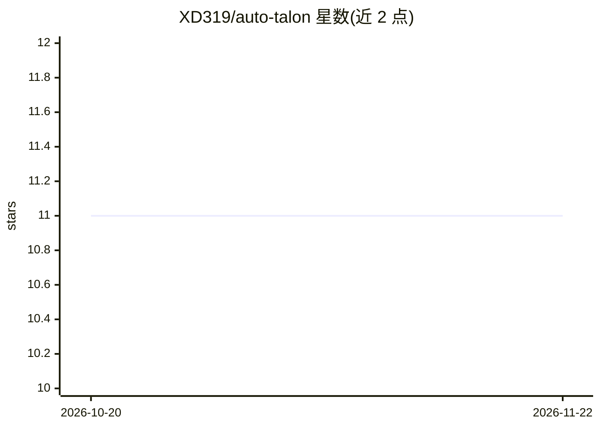

# XD319/auto-talon

⭐ 11 · TypeScript · MIT · 推送 2026-10-19 · [GitHub](https://github.com/XD319/auto-talon) · [官网](https://github.com/XD319/auto-talon#readme) · 个人维护 · 中文 README

**本地长期运行的个人 agent：定时执行日常任务并积累记忆**

本地优先的长运行个人 agent，通过 TUI/CLI/飞书/webhook/MCP 多入口共享同一运行时，可按计划自动执行编程与办公任务；工具调用受沙箱策略与审批规则治理，产生可回溯的 trace 与审计日志；分层记忆（profile/project/working）跨任务保留经验。默认关闭长期记忆。限制：需 Node.js >=22.13.0，面向单操作者本地使用，非托管 SaaS；Web UI 为 beta 预览。

## 筛选速览

| 维度 | 判定 | 备注 |
|---|---|---|
| AI 角色 | `ai-native` | 本体是模型或模型工具 |
| 许可风险 | `permissive` | MIT |
| 部署形态 | `library` | 以包/库形式分发 |
| 模型依赖 | local-ok | 支持本地模型 |
| 硬件要求 | — | 无带数字的原话,不猜 |
| 安装摩擦 | `low` | 无编译、无系统依赖或容器化 |
| 成熟度 | `idea` | |

## 能力要点

- TUI 聚合会话、审批、记忆、todo 与运行状态的单一 agent 界面
- 工具调用带沙箱策略、审批指纹与回滚快照
- 分层记忆与经验/技能引用，附 recall 来源说明
- 一个 provider 目录接入 OpenAI/Anthropic 兼容端点、Ollama、GLM 等多种供应商

## 适用场景

- 让 agent 定时自动执行编程和办公任务
- 本地环境中带审批与审计地使用 shell/文件工具
- 通过飞书/Lark 网关接入 agent 会话
- 跨任务积累项目记忆与技能引用

## 场景标签

`Agent 记忆` `AI 助手` · 领域:Agent 开发

## 证据(README 行号)

> L10: **AutoTalon is a local-first, long-running personal agent: it can automatically
> L233: |Governance|Sandbox scopes, approval prompts, persisted allow rules, audit log, and rollback snapshots|
> L29: - **Provider freedom**: configure OpenAI-compatible, Anthropic-compatible,

## 星数曲线

2026-10-20 11 → 2026-11-22 11（+0）

---
*卡片 v1 · prompt 1.4 · 生成 2026-11-18 · 置信度 high · 依据 README sha `d3940d26f418` · [字段定义](../../DATASET.md)*
