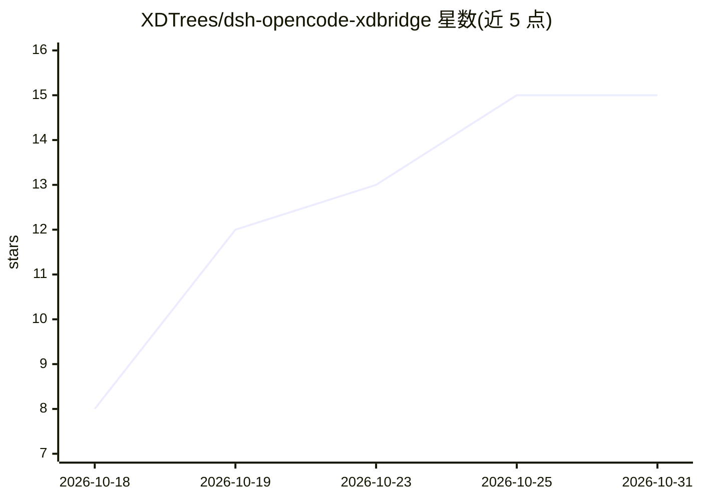

# XDTrees/dsh-opencode-xdbridge

⭐ 15 · JavaScript · MIT · 推送 2026-10-09 · [GitHub](https://github.com/XDTrees/dsh-opencode-xdbridge) · [官网](https://github.com/aosi526/dsh-opencode-xdbridge) · 个人维护 · 中文 README

**把 OpenCode Zen 免费模型接入 DSH 模型选择器的插件**

DSH（DeepSeek Harness）插件：下载官方 OpenCode 二进制，在隔离环境运行真实 opencode 进程以通过免费模型服务端门禁，本地转成 OpenAI 兼容回环端点后注册为 opencode-xdbridge 分组。附带设置页交互面板：模型目录、串行检测（区分超时与鉴权失败）、读取/重启操作；对模型动作全部拒绝本地执行并尽量转交 DSH 外部工具。仅暴露零计费维度的免费模型；报给 DSH 的是扣除预留与安全余量后的可用上下文预算。模型清单与可用性依赖上游，首次启动下载约 57 MB 运行时。

## 筛选速览

| 维度 | 判定 | 备注 |
|---|---|---|
| AI 角色 | `ai-ecosystem` | LLM/agent 周边工具 |
| 许可风险 | `permissive` | MIT |
| 部署形态 | `desktop` | 安装包/桌面程序 |
| 模型依赖 | — | README 未给出锁定关系 |
| 硬件要求 | — | 无带数字的原话,不猜 |
| 安装摩擦 | `low` | 无编译、无系统依赖或容器化 |
| 成熟度 | — | 结构信号不足 |

## 能力要点

- 下载官方 OpenCode 二进制并在隔离环境运行，通过免费模型门禁
- 本地回环 OpenAI 兼容端点，Host/Origin 校验、Bearer 常量时间比较、请求体上限 8 MB
- 设置页控制台：模型目录、串行检测、读取模型/检测全部/重启运行时
- 仅当模型所有计费维度为 0 才列出，不消耗用户额度

## 适用场景

- 在 DSH 里直接选用 OpenCode Zen 的免费模型
- 在设置面板查看各模型能力、状态与检测详情
- 上下文超限时获得明确提示而非透传含糊上游错误

## 场景标签

`模型网关` · 领域:Agent 开发

## 证据(README 行号)

> L11: 把 OpenCode 的免费模型（big-pickle、LongCat、MiMo、Nemotron、Space Bunny 等）接进 DSH 的模型选择器，作为 `opencode-xdbridge` 分组使用，并在**设置 → 
> L28: 所以本插件**不自造协议技巧**，而是：下载官方 OpenCode 二进制 → 在隔离环境里跑起来 → 在本地转成 OpenAI 兼容端点 → 注册给 DSH。
> L182:    │  (pi-ai provider "opencode-xdbridge")

## 星数曲线

2026-10-18 8 → 2026-10-31 15（+7）

---
*卡片 v1 · prompt 1.4 · 生成 2026-10-31 · 置信度 high · 依据 README sha `de21f9d93485` · [字段定义](../../DATASET.md)*
