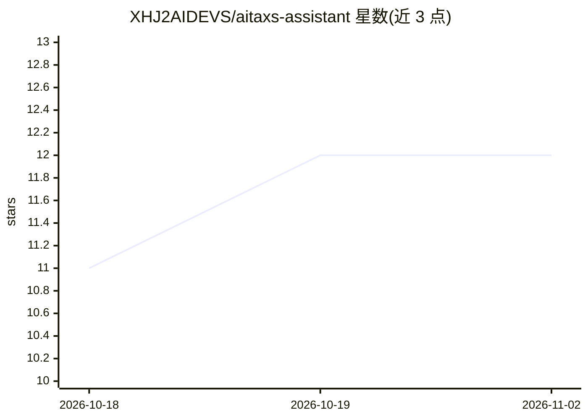

# XHJ2AIDEVS/aitaxs-assistant

⭐ 12 · HTML · 推送 2026-03-20 · [GitHub](https://github.com/XHJ2AIDEVS/aitaxs-assistant) · [官网](https://gpt.cntaxs.com/smart-admin-api/upload/public/notice/5eb569d40189404aa3a1a3fd0f0141fa_20260317215606.png) · 个人维护 · 中文 README

**面向个体工商户与小微企业主的 AI 财税助手插件**

以 SKILL.md 定义 AI 行为的插件，安装到 WorkBuddy / CodeBuddy 对话框后使用。功能包括工资个税、经营所得、增值税、企业所得税、印花税的精确计算（含计算过程）、税务知识问答、发票开具/抵扣指导、申报周期提醒与节税建议，并内置 H5 可视化计算界面；另提供可独立调用的 Python 计算脚本。支持 9 项个税专项附加扣除与小微企业所得税优惠。README 声明结果仅供参考，需以税务局官网及税务师意见为准。

## 筛选速览

| 维度 | 判定 | 备注 |
|---|---|---|
| AI 角色 | `ai-native` | 本体是模型或模型工具 |
| 许可风险 | `none` | — |
| 部署形态 | `None` |  |
| 模型依赖 | — | README 未给出锁定关系 |
| 硬件要求 | — | 无带数字的原话,不猜 |
| 安装摩擦 | `low` | 无编译、无系统依赖或容器化 |
| 成熟度 | — | 结构信号不足 |

## 能力要点

- 四大税种精确计算并展示完整计算过程
- 内置 H5 可视化税务计算器界面
- Python 计算脚本可脱离 AI 直接命令行调用
- 覆盖 9 项个税专项附加扣除与小微企业所得税优惠

## 适用场景

- 个体户/小微企业主直接对话查询税额计算与优惠政策
- 获取发票开具、抵扣、报销的合规操作指导
- 查看各税种申报周期与截止提醒

## 场景标签

`聊天机器人` · 领域:对话与助手

## 证据(README 行号)

> L8: **面向个体工商户和小微企业主的一站式 AI 财税助手**
> L79: ├── SKILL.md                    # AI 行为定义（核心）

## 星数曲线

2026-10-18 11 → 2026-11-02 12（+1）

---
*卡片 v1 · prompt 1.4 · 生成 2026-11-01 · 置信度 high · 依据 README sha `b989eb3b88e0` · [字段定义](../../DATASET.md)*
