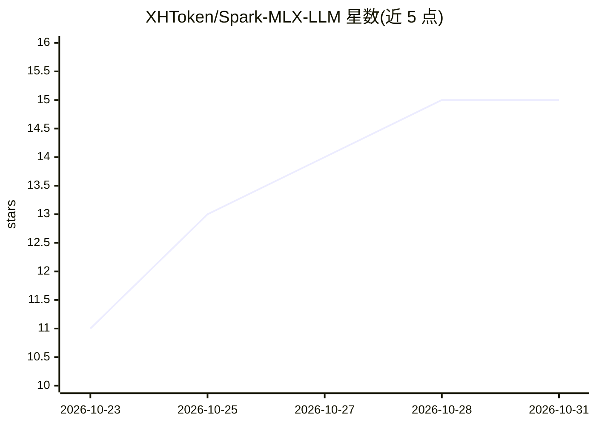

# XHToken/Spark-MLX-LLM

⭐ 15 · Python · Apache-2.0 · 推送 2026-10-27 · [GitHub](https://github.com/XHToken/Spark-MLX-LLM) · 个人维护 · 中文 README

**在 Apple Silicon 上本地推理部署 Spark 模型的 MLX 适配运行时**

基于 MLX 与 MLX LM 构建的本地推理项目，将 Spark 2.6/2.5 的模型架构与混合精度量化方案适配到 MLX：支持把 BF16 与 compressed-tensors INT4 checkpoint 转换为 MLX 格式，权重按模块分别使用 INT4/INT8/BF16。提供专用 QKV/RoPE、线性与 INT8 KV attention 算子的 Apple Silicon 优化，并含命令行生成、交互式聊天、Python 生成/流式 API 与 HTTP 服务。要求 Apple Silicon、macOS >= 26.2、原生 arm64 CPython 与 Xcode Metal 4 编译器；W8A8 加速需 Apple M5 或更新硬件及配套扩展，缺失时回退到浮点激活路径。也支持 Linux/CUDA 安装（见环境指南），推理需 Metal 或 CUDA GPU。

## 筛选速览

| 维度 | 判定 | 备注 |
|---|---|---|
| AI 角色 | `ai-ecosystem` | LLM/agent 周边工具 |
| 许可风险 | `permissive` | Apache-2.0 |
| 部署形态 | `None` |  |
| 模型依赖 | — | README 未给出锁定关系 |
| 硬件要求 | — | 无带数字的原话,不猜 |
| 安装摩擦 | `medium` | 含编译或系统依赖之一 |
| 成熟度 | — | 结构信号不足 |

## 能力要点

- Spark 模型 BF16/INT4 checkpoint 到 MLX 格式的转换
- INT4/INT8/BF16 混合精度量化，可选 W8A8/native 后端
- 专用 QKV/RoPE、线性与 INT8 KV attention 的 Apple Silicon 算子
- CLI 生成/聊天、Python 生成/流式 API、HTTP 服务多种接口

## 适用场景

- 把 Spark 2.6/2.5 模型转换后在 Mac 上本地部署推理
- 本机起 HTTP 服务供其他应用调用 Spark 模型
- 按精度需求调整权重与 KV cache 量化配置

## 场景标签

`推理引擎` `模型量化` · 领域:训练与推理

## 证据(README 行号)

> L7: Spark-MLX-LLM is a local inference project for **Spark 2.6 and Spark 2.5**, built on
> L11: model conversion, text generation, interactive chat, and HTTP serving to make

## 星数曲线

2026-10-23 11 → 2026-10-31 15（+4）

---
*卡片 v1 · prompt 1.4 · 生成 2026-10-30 · 置信度 high · 依据 README sha `fb1cf0522f06` · [字段定义](../../DATASET.md)*
