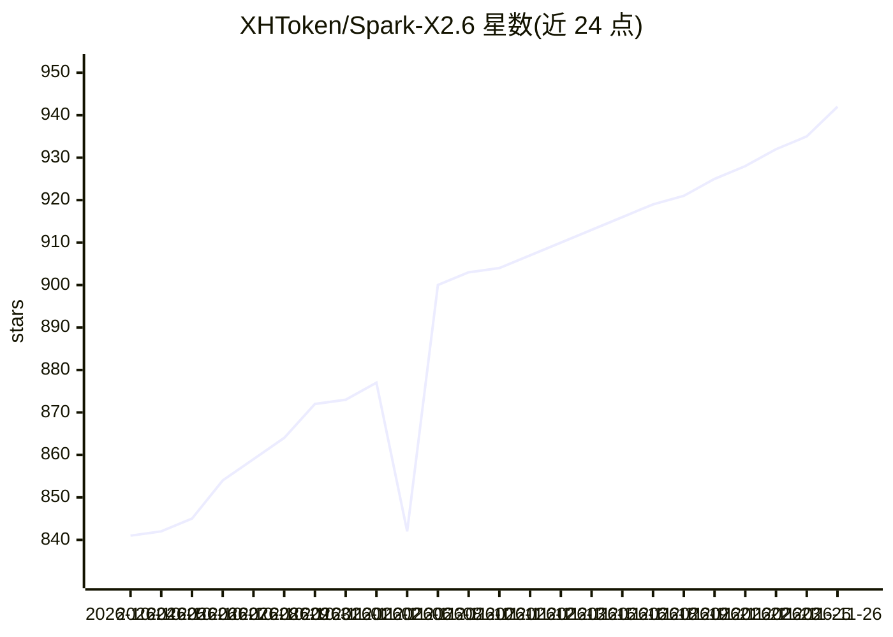

# XHToken/Spark-X2.6

⭐ 942 · Apache-2.0 · 推送 2026-11-25 · [GitHub](https://github.com/XHToken/Spark-X2.6) · [官网](https://xhtoken.ai/) · 组织维护

**面向端侧部署的开源小模型系列，供开发者本地运行 agent 任务**

Spark-X2.6 是 4B 与 1.7B 两个尺寸的端侧通用语言模型系列，架构延续 Spark-X2.5，通过后训练提升编码、工具调用、多步规划与长上下文能力。README 提供三种思考预算级别（none/low/high），并给出 Transformers、SGLang、vLLM、MLX、llama.cpp、Ollama、LM Studio 等多种本地推理与部署路径，模型以 Apache 2.0 许可发布，可通过 Hugging Face、ModelScope、Ollama 下载。

## 筛选速览

| 维度 | 判定 | 备注 |
|---|---|---|
| AI 角色 | `ai-native` | 本体是模型或模型工具 |
| 许可风险 | `permissive` | Apache-2.0 |
| 部署形态 | `self-host` | docker 或自建部署 |
| 模型依赖 | local-ok | 支持本地模型 |
| 硬件要求 | — | 无带数字的原话,不猜 |
| 安装摩擦 | `low` | 无编译、无系统依赖或容器化 |
| 成熟度 | — | 结构信号不足 |

## 能力要点

- 4B/1.7B 两种尺寸，Apache 2.0 许可发布
- 三档可配置思考预算（none/low/high）
- llama.cpp 原生架构支持（spark2_5）与配套 MLX 运行工具
- README 覆盖多平台推理部署示例（SGLang/vLLM/Ollama/LM Studio）

## 适用场景

- 在手机/PC 等端侧设备本地运行 agent 与编码任务
- 在 NVIDIA GPU 或 Ascend NPU 上部署 OpenAI 兼容 API 服务
- 在 Apple Silicon 或 Linux 上离线推理

## 场景标签

 · 领域:端侧语言模型/LLM

## 证据(README 行号)

> L19: Building on the Spark-X2.5, we introduce **Spark-X2.6-4B&1.7B**, the latest generation of our compact, general-purp
> L66: ## Quickstart
> L247: ### Ollama

## 星数曲线

2026-10-24 841 → 2026-11-26 942（+101）

---
*卡片 v1 · prompt 1.4 · 生成 2026-11-25 · 置信度 high · 依据 README sha `71d66bef7724` · [字段定义](../../DATASET.md)*
