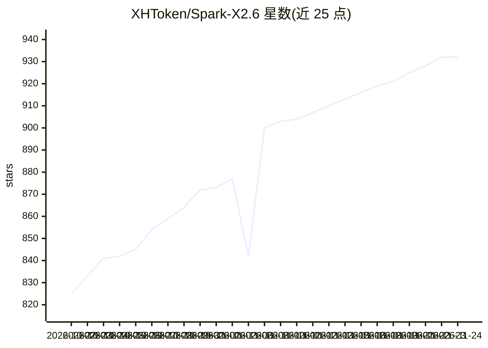

# XHToken/Spark-X2.6

⭐ 932 · Apache-2.0 · 推送 2026-11-22 · [GitHub](https://github.com/XHToken/Spark-X2.6) · [官网](https://xhtoken.ai/) · 组织维护

**端侧部署的开源 LLM 系列（4B/1.7B），面向开发者**

Spark-X26 是面向端侧（on-device）部署的开源语言模型系列，含 4B 与 1.7B 两个规格，架构延续 Spark-X2.5，通过后训练提升编码、agent 工具调用、长上下文与多语言能力。README 提供 Hugging Face/ModelScope/Ollama 下载渠道，并给出 Transformers、SGLang、vLLM、MLX、llama.cpp、LM Studio 等多种本地推理部署方式，支持 NVIDIA GPU 与华为 Ascend NPU，模型采用 Apache 2.0 许可。

## 筛选速览

| 维度 | 判定 | 备注 |
|---|---|---|
| AI 角色 | `ai-native` | 本体是模型或模型工具 |
| 许可风险 | `permissive` | Apache-2.0 |
| 部署形态 | `self-host` | docker 或自建部署 |
| 模型依赖 | local-ok | 支持本地模型 |
| 硬件要求 | — | 无带数字的原话,不猜 |
| 安装摩擦 | `low` | 无编译、无系统依赖或容器化 |
| 成熟度 | — | 结构信号不足 |

## 能力要点

- 提供 4B 与 1.7B 两个规格的端侧模型
- 三档思考预算（none/low/high）可配置
- 支持 Transformers/SGLang/vLLM/MLX/llama.cpp/Ollama/LM Studio 多种运行方式
- 支持 NVIDIA GPU 与 Ascend NPU 部署

## 适用场景

- 在本地设备上运行 LLM 做 agent 工具调用与编码任务
- 在 NVIDIA GPU 或 Ascend NPU 服务器上部署 OpenAI 兼容 API
- 用 MLX 或 llama.cpp 在 Apple Silicon/本地环境做推理

## 场景标签

`推理引擎` · 领域:训练与推理

## 证据(README 行号)

> L1: Spark-X2.6-4B & 1.7B: Advancing the Frontier of On-Device Agents for Real-World Tasks
> L19: Building on the Spark-X2.5, we introduce **Spark-X2.6-4B&1.7B**, the latest generation of our compact, general-purp
> L31: ## Model Downloads

## 星数曲线

2026-10-22 825 → 2026-11-24 932（+107）

---
*卡片 v1 · prompt 1.4 · 生成 2026-11-24 · 置信度 mid · 依据 README sha `3f68ffd2447c` · [字段定义](../../DATASET.md)*
