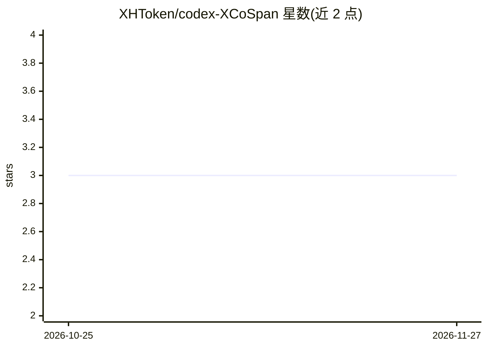

# XHToken/codex-XCoSpan

⭐ 3 · JavaScript · Apache-2.0 · 推送 2026-10-21 · [GitHub](https://github.com/XHToken/codex-XCoSpan) · 个人维护 · 中文 README

**Codex 插件：本地模型与云端分析协同，本地脱敏并人工审核**

面向 Codex 的插件，将本地部署的主会话模型与云端分析协同：简单任务留在本地，含敏感材料的复杂任务先在本地生成脱敏预览，用户比对全文并确认后才把内容递交云端分析，结果回传本地交付。提供 main（原生子代理，共享单一 provider，需第三方网关按模型 ID 路由并适配 Responses API）与 exec（独立进程，可分 provider）两个分支。需 Node.js 20+ 与 Codex CLI/desktop，安装方式包括 Git marketplace、桌面 ZIP 导入、命令行与源码。

## 筛选速览

| 维度 | 判定 | 备注 |
|---|---|---|
| AI 角色 | `ai-ecosystem` | LLM/agent 周边工具 |
| 许可风险 | `permissive` | Apache-2.0 |
| 部署形态 | `desktop` | 安装包/桌面程序 |
| 模型依赖 | — | README 未给出锁定关系 |
| 硬件要求 | — | 无带数字的原话,不猜 |
| 安装摩擦 | `low` | 无编译、无系统依赖或容器化 |
| 成熟度 | `idea` | |

## 能力要点

- 本地脱敏预览+人工确认/拒绝的云端递交流程
- main/exec 两种分支：共享 provider 路由或独立进程分别配置
- 默认检测器离线运行，可选检测服务
- 本地主会话模型需自行提前配置，插件不安装模型

## 适用场景

- 让 Codex 中含敏感材料的任务先脱敏并经我确认再上云
- 简单任务走本地模型、复杂任务委派云端模型
- 配合 Responses API 网关在本地与云端模型间按任务路由

## 场景标签

`编码 Agent` `模型网关` · 领域:Agent 开发

## 证据(README 行号)

> L11: A Codex plugin that coordinates a locally deployed main-session model with cloud analysis. Simple work stays local;
> L21: To use a local main-session model and a cloud subagent on `main`, first use a third-party gateway to expose both th
> L39: - Install Node.js 20+ to run the plugin's local service.

## 星数曲线

2026-10-25 3 → 2026-11-27 3（+0）

---
*卡片 v1 · prompt 1.4 · 生成 2026-11-22 · 置信度 high · 依据 README sha `f7783ce63919` · [字段定义](../../DATASET.md)*
