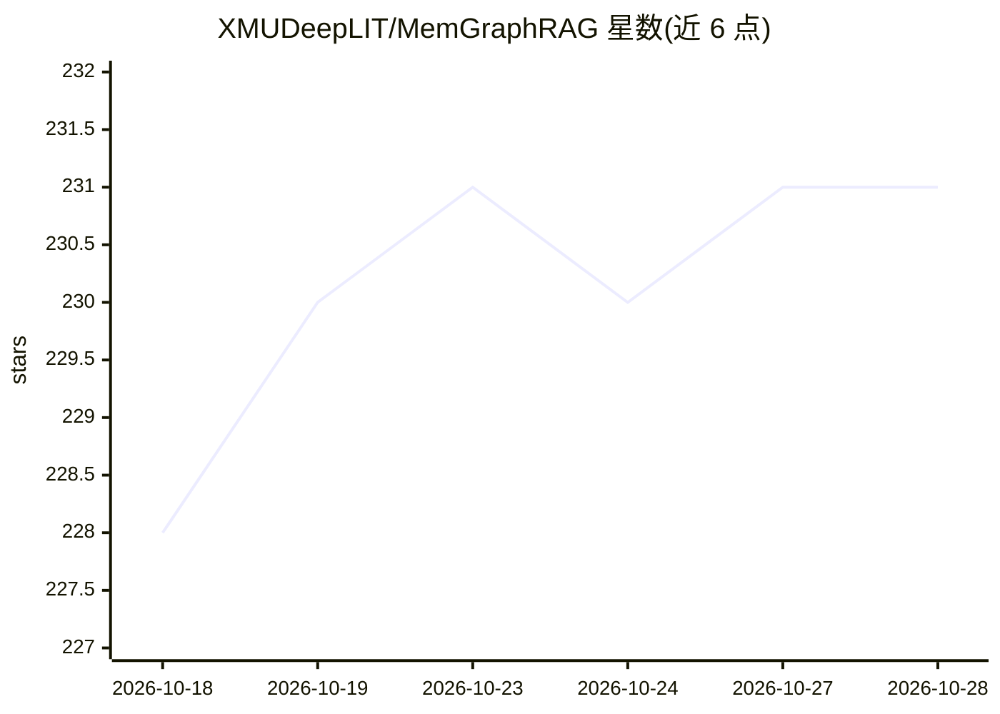

# XMUDeepLIT/MemGraphRAG

⭐ 232 · Python · MIT · 推送 2026-06-20 · [GitHub](https://github.com/XMUDeepLIT/MemGraphRAG) · [官网](https://arxiv.org/pdf/2606.00610) · 组织维护 · 中文 README

**三层记忆结构的 GraphRAG 框架：连接段落、事实与本体模式**

KDD 2026 论文的配套框架，将非结构化语料组织为本体模式层、事实三元组层与原文段落层三层记忆，层间双向链接。构建流程包含事实抽取、本体归纳、基于段落证据的冲突检测与消解，再生成类型/实体/段落节点图；检索结合嵌入相似度与 Personalized PageRank，批量问答记录答案、延迟与 token 用量。面向科研用户，通过 OpenAI 兼容端点与本地 Hugging Face 嵌入模型运行，离线 OpenIE 需另装 vllm 或 llama-factory。

## 筛选速览

| 维度 | 判定 | 备注 |
|---|---|---|
| AI 角色 | `ai-ecosystem` | LLM/agent 周边工具 |
| 许可风险 | `permissive` | MIT |
| 部署形态 | `library` | 以包/库形式分发 |
| 模型依赖 | local-ok | 支持本地模型 |
| 硬件要求 | — | 无带数字的原话,不猜 |
| 安装摩擦 | `low` | 无编译、无系统依赖或容器化 |
| 成熟度 | — | 结构信号不足 |

## 能力要点

- 三层记忆：模式/事实/段落双向链接
- 冲突感知的图构建（基于段落证据检测并消解冲突组）
- 本体归纳抽象事实为可复用模式并过滤低频模式
- 嵌入相似度 + Personalized PageRank 的图增强检索

## 适用场景

- 对纯文本语料构建带本体结构的 GraphRAG 索引
- 批量问答实验并记录答案、检索文档、延迟与 token 用量
- 研究冲突消解与模式归纳对图检索质量的影响

## 场景标签

`RAG` `知识图谱` `Agent 记忆` · 领域:Agent 开发

## 证据(README 行号)

> L7: > A memory-enhanced GraphRAG framework that connects unstructured passages, extracted facts, and abstract schemas in
> L43: - **Graph-enhanced retrieval:** combines embedding similarity and Personalized PageRank.

## 星数曲线

2026-10-18 228 → 2026-10-28 231（+3）

---
*卡片 v1 · prompt 1.4 · 生成 2026-10-22 · 置信度 mid · 依据 README sha `dd9e8b21d105` · [字段定义](../../DATASET.md)*
