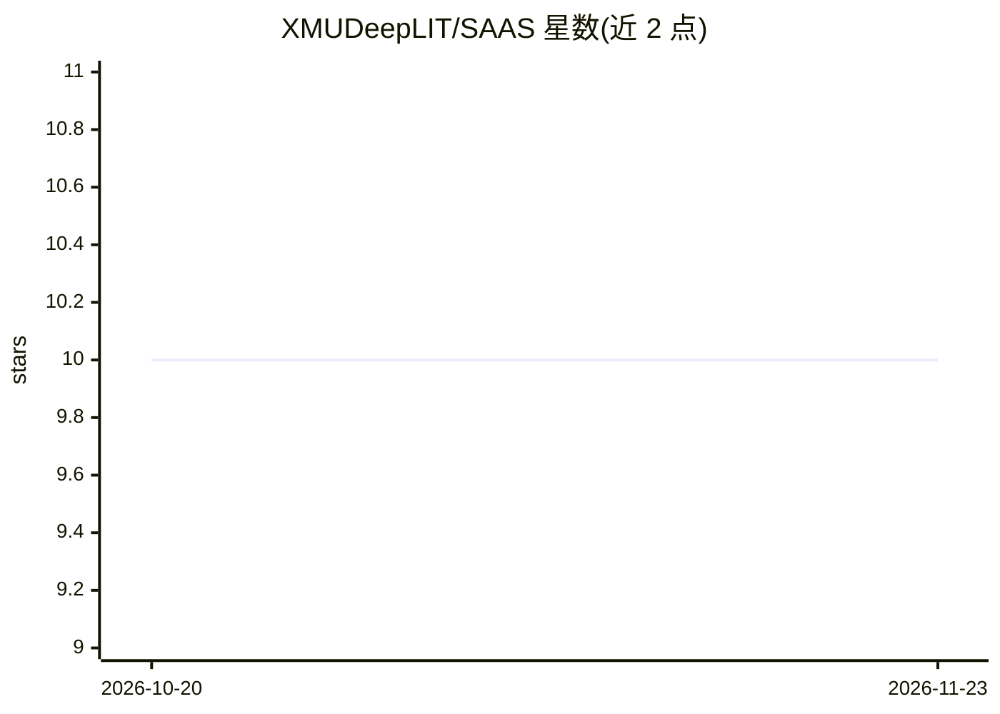

# XMUDeepLIT/SAAS

⭐ 10 · Python · Apache-2.0 · 推送 2026-06-13 · [GitHub](https://github.com/XMUDeepLIT/SAAS) · [官网](https://arxiv.org/abs/2605.29796) · 组织维护 · 中文 README

**研究者的 RL 训练框架：让搜索型 LLM 学会自我感知检索边界**

SAAS 是论文对应的开源实现，用强化学习训练搜索增强的 LLM 识别自身知识边界：对每个训练问题分别跑禁用搜索与启用搜索两组 rollout，将问题分类为 NO_SEARCH/NEED_SEARCH/UNDETERMINED，再施加边界感知奖励，配合两阶段课程（先能力获取、后效率精炼）训练。训练基于 slime 框架，检索后端支持 FAISS 本地检索服务器，输出 checkpoint、奖励明细与 TensorBoard 日志，可离线重算 Accuracy/Search Count/QOR/SOR 指标。

## 筛选速览

| 维度 | 判定 | 备注 |
|---|---|---|
| AI 角色 | `ai-native` | 本体是模型或模型工具 |
| 许可风险 | `permissive` | Apache-2.0 |
| 部署形态 | `library` | 以包/库形式分发 |
| 模型依赖 | — | README 未给出锁定关系 |
| 硬件要求 | — | 无带数字的原话,不猜 |
| 安装摩擦 | `low` | 无编译、无系统依赖或容器化 |
| 成熟度 | — | 结构信号不足 |

## 能力要点

- 双组 rollout 分类问题的边界判定机制
- 边界感知奖励：按问题类别差异化惩罚检索次数
- 两阶段课程训练（outcome-only → boundary-aware）
- 每次 rollout 输出边界决策与指标 JSON，可离线复算

## 适用场景

- 训练会按需检索、抑制过度搜索的问答模型
- 在 QA 基准上复现论文的 RL 训练流程
- 研究检索次数与推理质量的权衡

## 场景标签

`强化学习` `RAG` · 领域:知识与检索

## 证据(README 行号)

> L7: SAAS is an implementation of **Self-Aware Reinforcement Learning for Over-Search Mitigation in Agentic Search**. SAA
> L32: Use the `slimerl/slime:latest` image and initialize the environment required for Search-R1:

## 星数曲线

2026-10-20 10 → 2026-11-23 10（+0）

---
*卡片 v1 · prompt 1.4 · 生成 2026-11-20 · 置信度 high · 依据 README sha `36bf0d5a7d91` · [字段定义](../../DATASET.md)*
