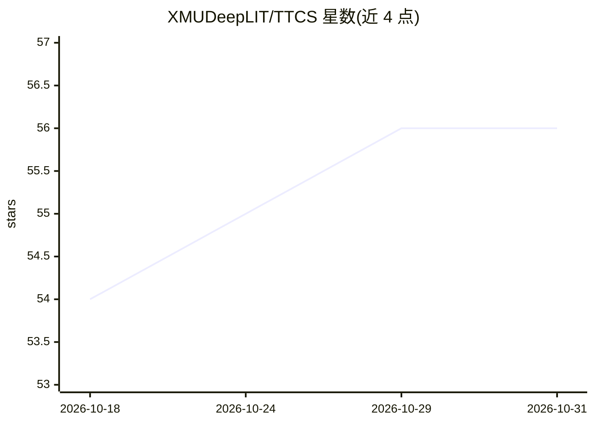

# XMUDeepLIT/TTCS

⭐ 56 · Python · 推送 2026-10-23 · [GitHub](https://github.com/XMUDeepLIT/TTCS) · [官网](https://arxiv.org/abs/2601.22628) · 组织维护

**面向科研者的 LLM 数学推理测试时自进化训练框架**

NeurIPS 2026 论文的代码实现：TTCS 在测试时通过 Synthesizer 与 Solver 两个策略的 GRPO 迭代闭环协同进化，提升 LLM 数学推理表现。Synthesizer 围绕测试题生成课程变体，Solver 在合成题与测试题混合数据上在线自进化，采用自一致性多数投票生成伪标签，无需外部监督。模型无关，实验覆盖 1.5B-7B 骨干模型，推荐 4-8 GPU 服务器运行。以源码加脚本形式提供。

## 筛选速览

| 维度 | 判定 | 备注 |
|---|---|---|
| AI 角色 | `ai-ecosystem` | LLM/agent 周边工具 |
| 许可风险 | `none` | — |
| 部署形态 | `library` | 以包/库形式分发 |
| 模型依赖 | — | README 未给出锁定关系 |
| 硬件要求 | — | 无带数字的原话,不猜 |
| 安装摩擦 | `low` | 无编译、无系统依赖或容器化 |
| 成熟度 | — | 结构信号不足 |

## 能力要点

- Synthesizer-Solver 双策略闭环协同进化训练
- 自一致性奖励生成伪标签，无需外部监督
- 模型无关，支持替换骨干 LLM（1.5B-7B 实验覆盖）
- 提供 GPU 自动分配的运行脚本与独立评估脚本

## 适用场景

- 在测试时自进化提升 LLM 数学推理基准表现
- 复现论文中 AIME/AMC/MATH-500 等基准实验
- 在自有骨干模型上执行测试时训练并评估

## 场景标签

`强化学习` · 领域:训练与推理

## 证据(README 行号)

> L24: **TTCS (Test-Time Curriculum Synthesis)** is a co-evolving test-time training framework built on an iterative GRPO 
> L27: - The **Synthesizer** generates curriculum variants for each test question, rewarded to preserve the reasoning stru
> L28: - The **Solver** performs online self-evolving on a mixture of synthetic and test questions, guided by self-consist

## 星数曲线

2026-10-18 54 → 2026-10-31 56（+2）

---
*卡片 v1 · prompt 1.4 · 生成 2026-10-24 · 置信度 mid · 依据 README sha `7ccdbb857232` · [字段定义](../../DATASET.md)*
