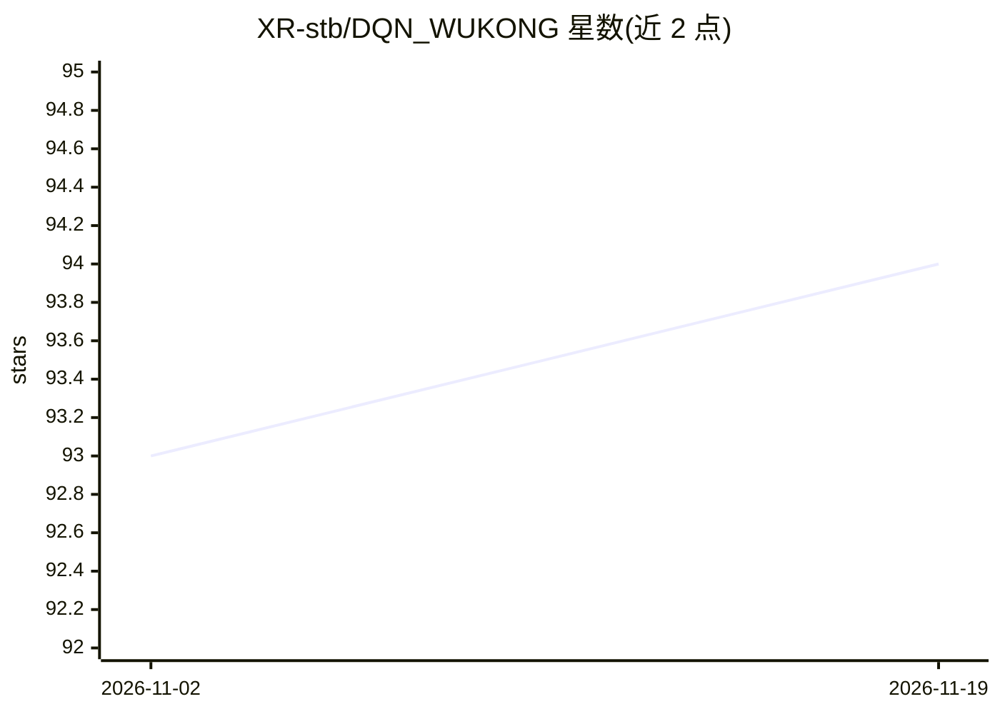

# XR-stb/DQN_WUKONG

⭐ 94 · Python · 推送 2026-09-14 · [GitHub](https://github.com/XR-stb/DQN_WUKONG) · 个人维护 · 中文 README

**用 DQN 强化学习玩黑神话悟空的 AI 项目**

基于 PyTorch 的强化学习实践项目，训练 DQN 智能体自动游玩《黑神话：悟空》：通过捕获 1280x720 窗口画面、识别血条信息（window.py 定义坐标），结合自定义奖励函数（judge.py）与 YAML 配置的动作空间进行训练。提供 Conda/venv 两种环境搭建方式，训练需游戏处于窗口模式并锁定 boss 视角。README 附 B 站演示视频，部分代码来自 DQN_play_sekiro 与 pygta5 仓库。

## 筛选速览

| 维度 | 判定 | 备注 |
|---|---|---|
| AI 角色 | `ai-native` | 本体是模型或模型工具 |
| 许可风险 | `none` | — |
| 部署形态 | `library` | 以包/库形式分发 |
| 模型依赖 | — | README 未给出锁定关系 |
| 硬件要求 | — | 无带数字的原话,不猜 |
| 安装摩擦 | `medium` | 含编译或系统依赖之一 |
| 成熟度 | — | 结构信号不足 |

## 能力要点

- DQN 智能体自动进行《黑神话：悟空》boss 对战
- 画面捕获与血量识别作为状态输入（1280x720 窗口）
- 自定义奖励函数与动作空间 YAML 配置
- 提供训练数据可视化脚本（train_data/*.py）

## 适用场景

- 想实践强化学习在 3D 动作游戏中的应用
- 参考游戏画面识别与奖励函数设计思路
- 基于此改造到其他类似游戏

## 场景标签

`强化学习` · 领域:训练与推理

## 证据(README 行号)

> L56: - judge.py: 奖励函数
> L62: 启动脚本训练，根据提示按g可暂停和开始，启动脚本后，需要进入boss对战看到boss血条后，等待几秒即可启动模型。

## 星数曲线

2026-11-02 93 → 2026-11-19 94（+1）

---
*卡片 v1 · prompt 1.4 · 生成 2026-11-17 · 置信度 high · 依据 README sha `310bd65137c3` · [字段定义](../../DATASET.md)*
