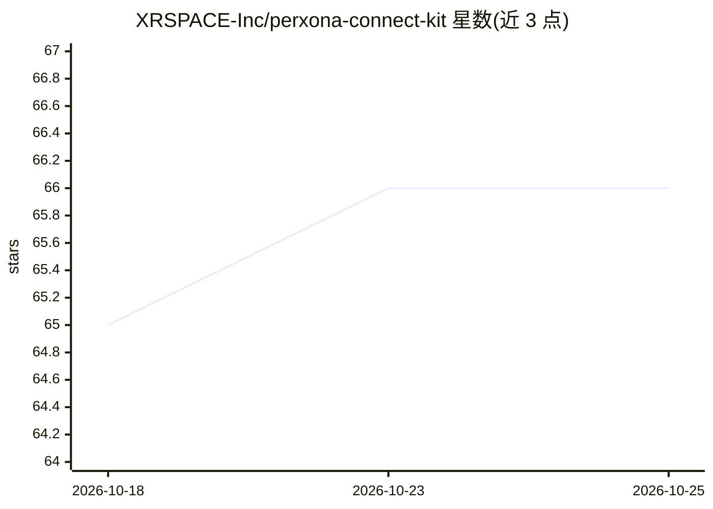

# XRSPACE-Inc/perxona-connect-kit

⭐ 66 · JavaScript · Apache-2.0 · 推送 2026-10-15 · [GitHub](https://github.com/XRSPACE-Inc/perxona-connect-kit) · [官网](https://connect.perxona.ai) · 组织维护

**在 Web 应用中接入会说话的 3D AI 虚拟人的 SDK 示例与工具集**

XRSPACE 开源的 Perxona Connect SDK 配套套件：提供 `<sv-presenter>` Web 组件，开发者选定虚拟形象、场景与语音后即可在网页中呈现带口型同步（lip-sync）与语音合成的说话虚拟人。包含 Express 起步示例、VRM 文件检查上传脚本及集成 FAQ。使用需 Node 22+ 与 Perxona Connect 账号（含 API key），依赖云端计量计费的 Connect API，Free Plan 额度用尽或订阅失效会导致调用失败。面向 Web 开发者。

## 筛选速览

| 维度 | 判定 | 备注 |
|---|---|---|
| AI 角色 | `ai-ecosystem` | LLM/agent 周边工具 |
| 许可风险 | `permissive` | Apache-2.0 |
| 部署形态 | `library` | 以包/库形式分发 |
| 模型依赖 | — | README 未给出锁定关系 |
| 硬件要求 | — | 无带数字的原话,不猜 |
| 安装摩擦 | `low` | 无编译、无系统依赖或容器化 |
| 成熟度 | — | 结构信号不足 |

## 能力要点

- `<sv-presenter>` Web 组件实现说话虚拟人嵌入
- 口型同步、语音合成与 VRM 虚拟形象支持
- Express 起步示例与 VRM 上传工具
- 支持 `[MOTION ...]` 标记在语音中触发动作

## 适用场景

- 在网站中添加 AI 客服/礼宾虚拟人
- 为产品构建语音导购或新手引导虚拟人
- 用自己的 .vrm 文件制作 VTuber 风格角色

## 场景标签

`语音 Agent` `语音合成` · 领域:对话与助手

## 证据(README 行号)

> L3: **Add a talking 3D AI avatar to your web app.** Samples and tools for the Perxona Connect SDK: drop in the `<sv-pres
> L9: Needs Node 22+ and a free Perxona Connect account (sign up).

## 星数曲线

2026-10-18 65 → 2026-10-25 66（+1）

---
*卡片 v1 · prompt 1.4 · 生成 2026-10-24 · 置信度 high · 依据 README sha `9c88a81ee206` · [字段定义](../../DATASET.md)*
