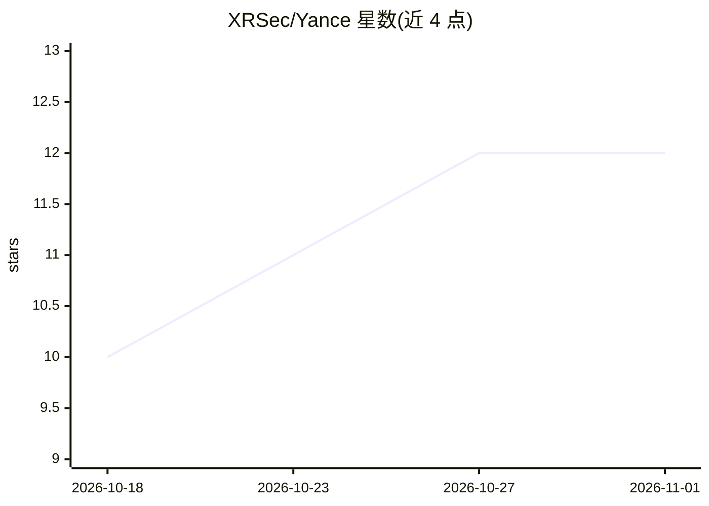

# XRSec/Yance

⭐ 12 · Swift · 推送 2026-10-29 · [GitHub](https://github.com/XRSec/Yance) · 个人维护 · 中文 README

**本地优先的多平台个人关系与沟通辅助大脑（MCP 驱动）**

由多个 MCP 连接器驱动的本地优先沟通智能系统：把微信、小红书、闲鱼、钉钉、飞书等平台的聊天关联到人物、账号、身份与关系，维护带证据和时效范围的长期记忆，生成目标与代价不同的三种回复策略（推进结果/维护关系/设边界），并在积累反馈与验证后允许受限、可审计、可暂停的自动回复。当前处于 implementation prototype 阶段，含 Electron + Node.js Server Core 原型（MCP 注册、Connector Runtime、SQLite 数据查看），无正式发行版，真实平台兼容性 UNTESTED，License 与最低系统版本 UNSPECIFIED。

## 筛选速览

| 维度 | 判定 | 备注 |
|---|---|---|
| AI 角色 | `ai-native` | 本体是模型或模型工具 |
| 许可风险 | `none` | — |
| 部署形态 | `None` |  |
| 模型依赖 | — | README 未给出锁定关系 |
| 硬件要求 | — | 无带数字的原话,不猜 |
| 安装摩擦 | `low` | 无编译、无系统依赖或容器化 |
| 成熟度 | `idea` | |

## 能力要点

- 跨平台身份图谱：区分真实人物、平台账号、身份、关系与场景，关联由用户确认且可撤销
- 三种目标与代价不同的回复策略，指出润色是否改变事实、金额、责任或关系姿态
- 自动回复需显式授权，默认到期、可撤销，多种风险条件触发暂停并交还用户
- 平台接入复用独立 MCP 连接器，模型不接触平台凭据，读写发送分级授权

## 适用场景

- 在回复重要消息前查看对方身份、关系上下文与多种策略的取舍
- 长期记录每个联系人的偏好、边界与关系变化并保留证据
- 对明确范围内的会话开启受限、可审计的自动回复

## 场景标签

`Agent 记忆` `AI 助手` · 领域:Agent 开发

## 证据(README 行号)

> L7: 它把散落在微信、小红书、闲鱼、钉钉、飞书等平台上的聊天放回真实的人、账号、身份、关系和场景中，帮助用户理解上下文、维护长期记忆，并生成目标和代价不同的回复策略。系统早期只提供建议并由人确认；经过持续反馈和专项验证后，用户可以对明确身
> L63: 用户选择策略后再生成可编辑草稿。系统会指出润色是否改变了事实、金额、日期、责任或关系姿态，而不是只提供“正式一点”“温柔一点”的同义改写。
> L102: Yance 不打算重复维护每个平台的解密、逆向、自动化或开放 API 适配。微信、小红书、闲鱼、钉钉、飞书及业务系统由独立 MCP 或受控 computer-use 能力接入。

## 星数曲线

2026-10-18 10 → 2026-11-01 12（+2）

---
*卡片 v1 · prompt 1.4 · 生成 2026-11-01 · 置信度 mid · 依据 README sha `0910cb8f4d34` · [字段定义](../../DATASET.md)*
