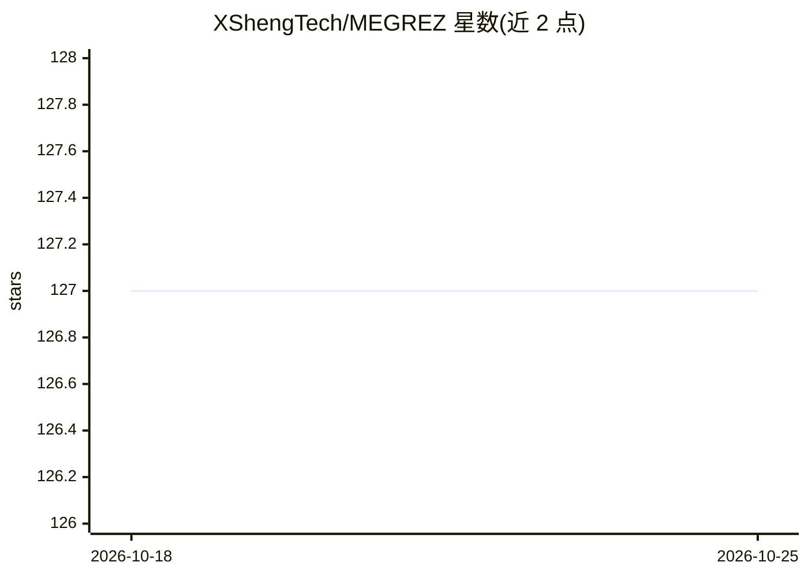

# XShengTech/MEGREZ

⭐ 127 · Go · AGPL-3.0 · 推送 2025-12-07 · [GitHub](https://github.com/XShengTech/MEGREZ) · [官网](http://docs.megrez.xsheng-ai.com) · 组织维护 · 中文 README

**开源多节点/多 GPU 容器化高性能计算管理平台**

基于 Golang、Vue3、Docker 与 NVIDIA Container Toolkit 构建的 GPU 资源管理平台：支持多节点多 GPU 调度、一键创建容器实例、环境与用户数据隔离、多用户支持，内置 PyTorch/TensorFlow/PaddlePaddle 深度学习环境预装、VSCode 网页版、Jupyter Notebook 与 Prometheus/Grafana 资源监控看板，提供节点/实例/用户/镜像的系统管理界面。面向需要共享 GPU 算力的团队或组织。部署通过独立仓库 MEGREZ-Deploy 完成。采用 AGPL-3.0 附加条款授权，另可联系购买闭源授权。

## 筛选速览

| 维度 | 判定 | 备注 |
|---|---|---|
| AI 角色 | `ai-ecosystem` | LLM/agent 周边工具 |
| 许可风险 | `viral` | AGPL-3.0 |
| 部署形态 | `None` |  |
| 模型依赖 | — | README 未给出锁定关系 |
| 硬件要求 | — | 无带数字的原话,不猜 |
| 安装摩擦 | `low` | 无编译、无系统依赖或容器化 |
| 成熟度 | — | 结构信号不足 |

## 能力要点

- 多节点、多 GPU 支持与容器实例环境隔离
- 深度学习环境（PyTorch/TensorFlow/PaddlePaddle）预安装
- 内置 VSCode 网页版、Jupyter Notebook 与 Grafana 资源监控看板
- 节点/实例/用户/镜像的系统管理功能

## 适用场景

- 团队或实验室统一管理和分配多节点 GPU 算力
- 为成员提供隔离的深度学习容器实例
- 通过网页版 VSCode 和 Jupyter 远程开发，并监控 GPU 使用情况

## 场景标签

`MLOps` · 领域:训练与推理

## 证据(README 行号)

> L9: 高效管理, 一键创建容器实例, 支持多节点/多GPU, 现代化 UI
> L13: Golang Vue3 Docker NVIDIA Container Toolkit
> L21: ✅ 多节点、多GPU支持

## 星数曲线

2026-10-18 127 → 2026-10-25 127（+0）

---
*卡片 v1 · prompt 1.4 · 生成 2026-10-23 · 置信度 high · 依据 README sha `9dd155c3eabe` · [字段定义](../../DATASET.md)*
