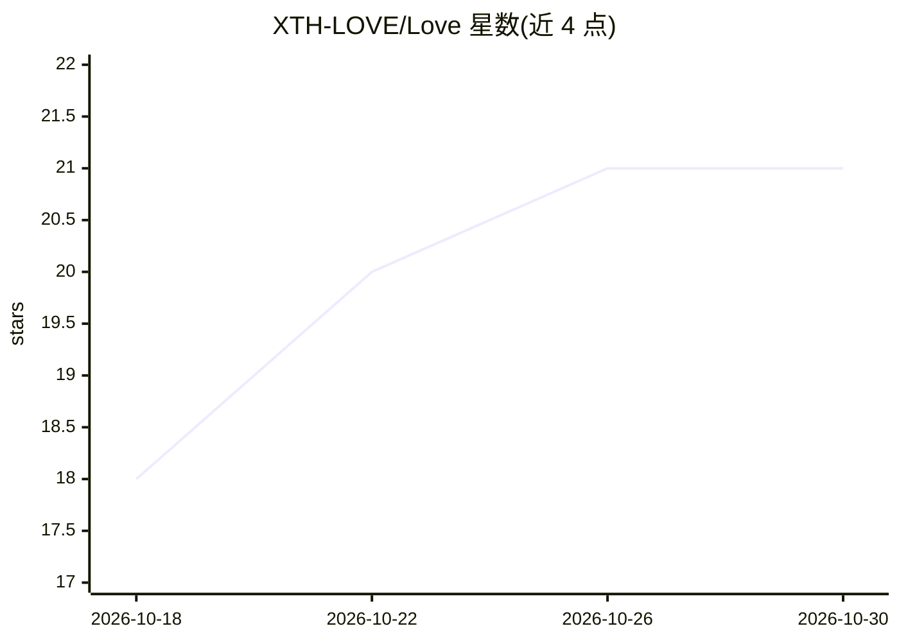

# XTH-LOVE/Love

⭐ 21 · Vue · MIT · 推送 2026-08-22 · [GitHub](https://github.com/XTH-LOVE/Love) · 个人维护 · 中文 README

**情侣双人私密共同空间：相册、时光轴、悄悄话与 AI 写作**

面向情侣的自托管双人私密空间应用，提供相册、时光轴、悄悄话实时消息、纪念日、清单、AI 约会策划/共同日记/情书生成、位置分享、音视频通话与 3D 共同宠物。基于 Nuxt 4/Vue 3/TypeScript 与 Supabase，可发布为静态网页、Android APK（Capacitor）或 Windows 桌面应用（Electron）。AI 通过 Supabase Edge Function 代理小米 MiMo 请求，API Key 保留在服务端；通话、地图等能力需配置 ZEGO、高德等外部服务。

## 筛选速览

| 维度 | 判定 | 备注 |
|---|---|---|
| AI 角色 | `ai-enhanced` | 去掉 AI 部分产品仍成立 |
| 许可风险 | `permissive` | MIT |
| 部署形态 | `library` | 以包/库形式分发 |
| 模型依赖 | — | README 未给出锁定关系 |
| 硬件要求 | — | 无带数字的原话,不猜 |
| 安装摩擦 | `low` | 无编译、无系统依赖或容器化 |
| 成熟度 | `idea` | |

## 能力要点

- AI 约会策划、共同日记与情书生成（Edge Function 代理小米 MiMo）
- Supabase RLS 与签名地址实现情侣空间数据隔离
- 同一代码库发布 Web/Android/Windows 三端
- 3D 共同宠物系统（Three.js，喂养、成长、进化）

## 适用场景

- 情侣共同记录照片、时光轴与纪念日
- 双人实时聊天、位置分享与音视频通话
- 让 AI 帮忙生成约会方案、共同日记和情书
- 开发者自托管一个私密的情侣空间替代公开社交网络

## 场景标签

`AI 写作` · 领域:内容生成

## 证据(README 行号)

> L34: **Love小家 (CoupleSpace)** is a private, realtime space for two people. It combines shared memories, albums, private 
> L94: - AI 约会策划：根据城市、预算和偏好生成约会方案。
> L127: |AI|小米 MiMo|约会策划、共同日记和情书生成|

## 星数曲线

2026-10-18 18 → 2026-10-30 21（+3）

---
*卡片 v1 · prompt 1.4 · 生成 2026-10-28 · 置信度 high · 依据 README sha `9d7e8ca6b075` · [字段定义](../../DATASET.md)*
