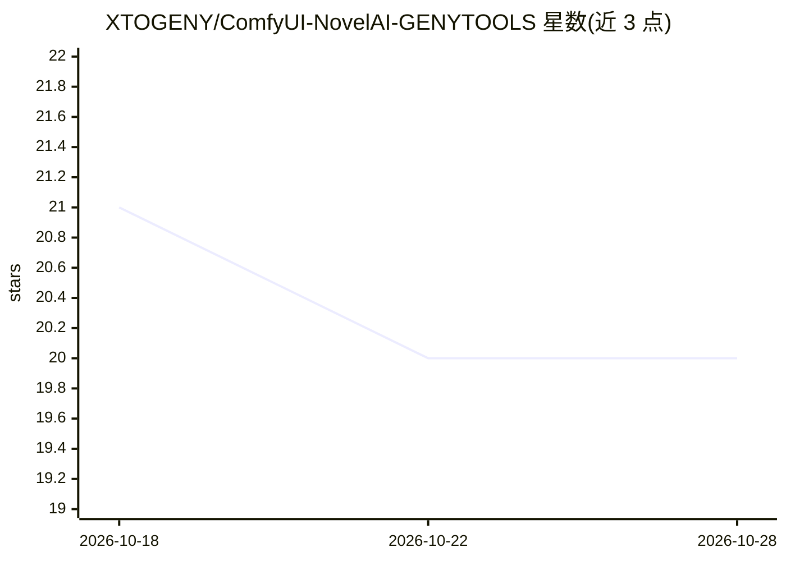

# XTOGENY/ComfyUI-NovelAI-GENYTOOLS

⭐ 20 · Python · MIT · 推送 2026-08-22 · [GitHub](https://github.com/XTOGENY/ComfyUI-NovelAI-GENYTOOLS) · 个人维护 · 中文 README

**ComfyUI 的 NovelAI 图像生成节点包**

面向 ComfyUI 的第三方 NovelAI 扩展节点包：把 NovelAI 的模型选择、正负提示词、生成参数、角色分区（V5 最多 32 个角色）、Vibe Transfer、精准参考、局部重绘、Enhance、Director Tools、批量任务、XY 参数对比与分块放大等功能拆为可连接的模块化节点，通过用户的 Persistent API Token 调用 NovelAI API，部分操作消耗 Anlas。节点与参数界面为中文；Token 不写入工作流 JSON、图片元数据或日志。支持 V5/V4.5/V4/V3 系列模型，V5 当前不支持 Vibe 与精准参考并在请求前提示。安装方式为下载 ZIP 或 git clone 到 custom_nodes 并 pip 安装依赖。

## 筛选速览

| 维度 | 判定 | 备注 |
|---|---|---|
| AI 角色 | `ai-ecosystem` | LLM/agent 周边工具 |
| 许可风险 | `permissive` | MIT |
| 部署形态 | `library` | 以包/库形式分发 |
| 模型依赖 | — | README 未给出锁定关系 |
| 硬件要求 | — | 无带数字的原话,不猜 |
| 安装摩擦 | `low` | 无编译、无系统依赖或容器化 |
| 成熟度 | `idea` | |

## 能力要点

- 覆盖文生图/图生图/局部重绘/角色分区/Vibe/精准参考/Director Tools 的模块化节点
- 分块放大：本地放大后分块 Img2Img，余弦羽化融合、稳定 Seed 与断点缓存续跑
- 批量提示词任务与最多 6×6 的 XY 参数对比图生成
- Token 隔离于工作流 JSON、节点输入、图片元数据与日志

## 适用场景

- 在 ComfyUI 工作流中调用 NovelAI 生成与编辑图片
- 用角色分区节点做多角色同图生成
- 对本地放大的大图执行分块精修与接缝处理
- 批量生成同风格系列图并做参数对比实验

## 场景标签

`图像生成` · 领域:内容生成

## 证据(README 行号)

> L5: 一个面向 ComfyUI 的 NovelAI 图像生成与编辑节点包。它把 NovelAI 的模型、提示词、生成参数、角色分区、Vibe、精准参考和采样器拆成可自由连接的模块，并补充批量任务、XY 参数对比、分块放大、图片保存和元数据
> L11: > 本项目是社区开发的非官方 ComfyUI 扩展，与 NovelAI 官方无隶属关系。调用 NovelAI API 需要用户自己的 Persistent API Token；生成、编码、增强和部分编辑操作可能消耗 Anlas。
> L15: - **ComfyUI 原生模块化设计**：工作流结构接近 `模型加载器 → LoRA/参考 → KSampler`，模型、提示词、参数和参考图均可独立复用。

## 星数曲线

2026-10-18 21 → 2026-10-28 20（-1）

---
*卡片 v1 · prompt 1.4 · 生成 2026-10-28 · 置信度 high · 依据 README sha `fc62ae18fd56` · [字段定义](../../DATASET.md)*
