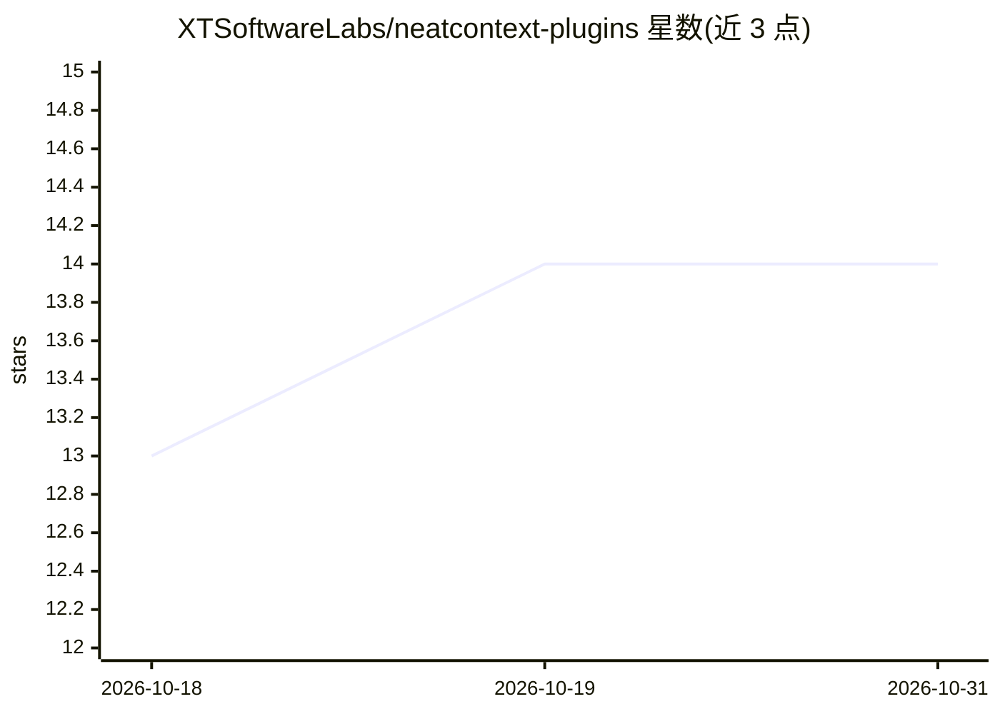

# XTSoftwareLabs/neatcontext-plugins

⭐ 14 · JavaScript · MIT · 推送 2026-08-23 · [GitHub](https://github.com/XTSoftwareLabs/neatcontext-plugins) · 组织维护

**把 AI 编程对话沉淀为可复用领域知识的插件套件**

面向 Claude Code、GitHub Copilot、Kimi Code、Codex、pi 等 AI 编程客户端的插件集合：从长对话中提取可复用的领域知识（排查过程、系统知识、决策、术语），保存为结构化 context（领域 profile + 知识文件夹），供后续会话通过 /neatcontext:use 接入或经 export/import 在团队间共享。保存时对会话转录做隐私过滤与密钥脱敏，context 本地存储于 ~/.neatcontext，插件不出站联网；支持 auto/ask/manual 三种上下文路由模式与 MCP 扩展声明机制。

## 筛选速览

| 维度 | 判定 | 备注 |
|---|---|---|
| AI 角色 | `ai-ecosystem` | LLM/agent 周边工具 |
| 许可风险 | `permissive` | MIT |
| 部署形态 | `None` |  |
| 模型依赖 | locked-api |  |
| 硬件要求 | — | 无带数字的原话,不猜 |
| 安装摩擦 | `low` | 无编译、无系统依赖或容器化 |
| 成熟度 | — | 结构信号不足 |

## 能力要点

- 从对话提取持久知识并合并进领域 profile 与知识文件夹
- 跨会话 /neatcontext:use 接入上下文，auto/ask/manual 路由模式
- export/import 机制支持团队间共享与分歧调和
- 本地存储、密钥脱敏、不出站联网；扩展经 extensions.json 绑定后才可执行

## 适用场景

- 把一次生产问题排查的结论保存下来，供以后新会话直接使用
- 团队共享某个系统的领域知识，避免每个成员重复解释
- 在不同 AI 编程客户端之间迁移同一份上下文

## 场景标签

`知识库管理` `Agent 记忆` · 领域:Agent 开发

## 证据(README 行号)

> L9: Extract domain knowledge and save useful work from Claude Code, GitHub Copilot,
> L31: already contain discoveries that will matter again. NeatContext extracts the
> L44: claude plugin marketplace add https://github.com/XTSoftwareLabs/neatcontext-plugins.git

## 星数曲线

2026-10-18 13 → 2026-10-31 14（+1）

---
*卡片 v1 · prompt 1.4 · 生成 2026-10-31 · 置信度 high · 依据 README sha `c9fd50f8ad45` · [字段定义](../../DATASET.md)*
