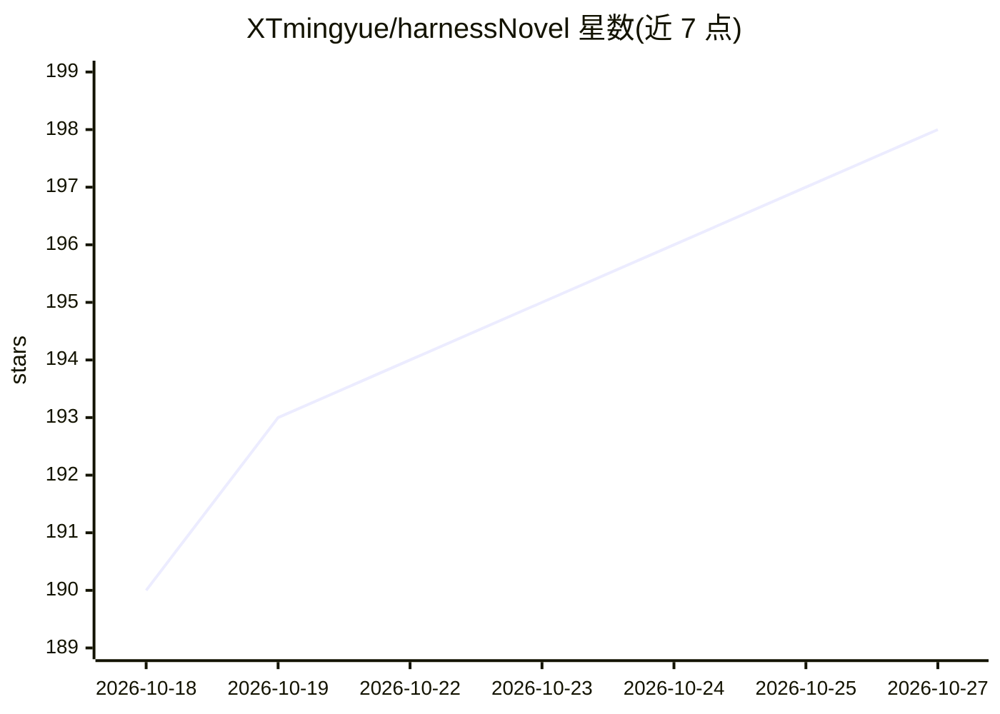

# XTmingyue/harnessNovel

⭐ 198 · Python · GPL-3.0 · 推送 2026-08-23 · [GitHub](https://github.com/XTmingyue/harnessNovel) · [官网](https://mp.weixin.qq.com/s/_GIBLfxKKc6VyMdx9oWhwA) · 个人维护 · 中文 README

**面向网文作者的「拆书+仿写」长篇小说自动化写作 AI Agent**

以 pip 安装的 Python CLI 与本地 Web 工作台，为长篇网络小说作者提供从参考小说结构化拆解（世界观、故事结构、情节单元、章节摘要），到新书玩法/主线/舞台/角色线设计、逐章章纲与正文生成的全流程自动化创作。三阶段可分别配置 OpenAI 兼容接口的模型（DeepSeek、智谱 GLM、Kimi 等）。支持可选机制层追踪系统文状态、目标世界资料库导入、断点续写，以及基于 Humanizer-zh 规则的正文去 AI 味后处理；参考小说仅支持 .txt 中文编码。

## 筛选速览

| 维度 | 判定 | 备注 |
|---|---|---|
| AI 角色 | `ai-native` | 本体是模型或模型工具 |
| 许可风险 | `viral` | GPL-3.0 |
| 部署形态 | `library` | 以包/库形式分发 |
| 模型依赖 | — | README 未给出锁定关系 |
| 硬件要求 | — | 无带数字的原话,不猜 |
| 安装摩擦 | `low` | 无编译、无系统依赖或容器化 |
| 成熟度 | — | 结构信号不足 |

## 能力要点

- 「拆书+仿写」双阶段：先把参考小说拆解为结构化知识再生成新书
- 从核心玩法、舞台路线图、角色线到章纲与正文的全流程命令
- 机制层（none/light_state/explicit_mechanics）结构化追踪面板与状态
- 基于 Humanizer-zh 规则的正文去 AI 味后处理，保留原稿备份
- 本地 Web 工作台支持各阶段多轮对话调整

## 适用场景

- 我想让 AI 参考一部优秀网文的节奏与结构来写我的新书
- 系统文/游戏文写作中需要稳定追踪境界、资源和任务状态
- 长篇连载创作中边写边迭代，中断后断点续写
- 对生成正文做去 AI 味精修

## 场景标签

`AI 写作` · 领域:内容生成

## 证据(README 行号)

> L7:  长篇网络小说写作 AI Agent
> L16:  一个专注于高质量网文创作的 AI 辅助工具。通过「拆书 + 仿写」的双阶段流程，显著提升 AI 生成小说的创作水准。
> L111: - **全流程自动化**：从拆书分析、玩法设计到正文生成，串联命令完成完整长篇小说

## 星数曲线

2026-10-18 190 → 2026-10-27 198（+8）

---
*卡片 v1 · prompt 1.4 · 生成 2026-10-22 · 置信度 high · 依据 README sha `57c7a6aab64b` · [字段定义](../../DATASET.md)*
