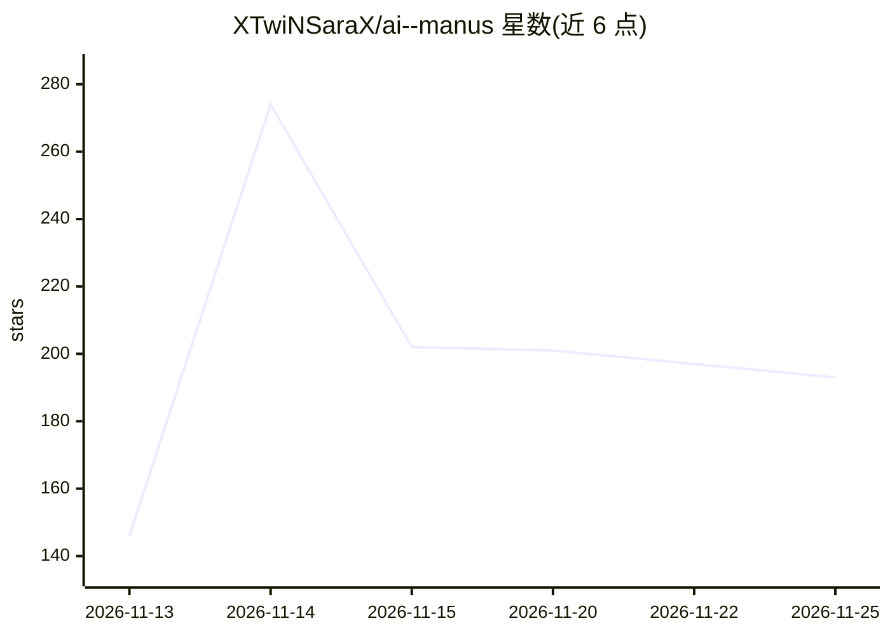

# XTwiNSaraX/ai--manus

⭐ 193 · Apache-2.0 · 推送 2026-11-13 · [GitHub](https://github.com/XTwiNSaraX/ai--manus) · 个人维护

**面向个人用户的自主 AI Agent：代为执行代码与浏览器操作**

自称 Manus 的自主 AI Agent 系统，README 描述其可在用户授权下自主编写并执行脚本、控制浏览器完成表单填写与信息收集等多步骤任务，定位为家庭、学习与轻量办公场景的个人助手，非企业平台。给出最低双核 CPU、4 GB 内存的兼容性表与六步上手流程。README 未提供任何安装命令、代码入口或技术架构说明，仅含下载提示与搜索关键词列表。

## 筛选速览

| 维度 | 判定 | 备注 |
|---|---|---|
| AI 角色 | `ai-native` | 本体是模型或模型工具 |
| 许可风险 | `permissive` | Apache-2.0 |
| 部署形态 | `None` |  |
| 模型依赖 | — | README 未给出锁定关系 |
| 硬件要求 | — | 无带数字的原话,不猜 |
| 安装摩擦 | `low` | 无编译、无系统依赖或容器化 |
| 成熟度 | — | 结构信号不足 |

## 能力要点

- 自主执行代码与控制浏览器完成多步骤任务
- 面向学习、家庭项目与轻量办公的小规模场景
- README 列出最低 4 GB 内存/双核 CPU 的兼容性要求

## 适用场景

- 让代理自动收集网页信息、填写重复表单
- 代替自己运行小脚本与整理研究笔记
- 后台委派日常小型重复任务

## 场景标签

`AI 助手` `编码 Agent` `浏览器自动化` · 领域:效率与自动化

## 证据(README 行号)

> L10: - **Autonomous Code Execution:** Manus AI agent runs code on its own to complete tasks, so you can focus on decisio
> L18: Manus is an autonomous AI agent designed to run code and control a browser on your behalf. Instead of acting like a

## 星数曲线

2026-11-13 146 → 2026-11-25 193（+47）

---
*卡片 v1 · prompt 1.4 · 生成 2026-11-17 · 置信度 low · 依据 README sha `66ba5de9af15` · [字段定义](../../DATASET.md)*
