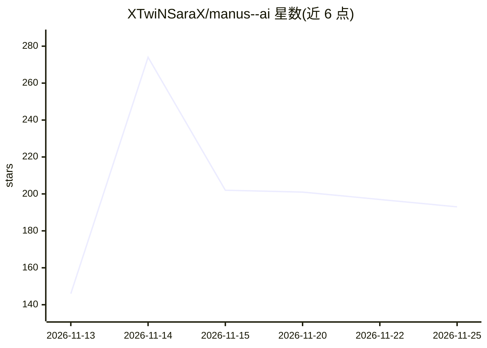

# XTwiNSaraX/manus--ai

⭐ 193 · Apache-2.0 · 推送 2026-11-13 · [GitHub](https://github.com/XTwiNSaraX/manus--ai) · 个人维护

**面向个人用户的自主 AI Agent：代跑代码与操控浏览器**

README 声明本产品为自主 AI agent，可代替用户编写并执行脚本、打开网页、与页面元素交互、执行多步任务，定位为面向家庭、学习与小规模工作的个人助手，覆盖整理研究、日程提醒、多页信息收集与轻量办公等场景。配套信息包括硬件兼容性表（最低双核 CPU、4 GB 内存）与六步上手说明（准备、配置、测试、细化、应用、维护）。README 未给出任何安装命令、代码仓库链接或技术实现细节，仅含下载与促销码条目，可验证事实有限。

## 筛选速览

| 维度 | 判定 | 备注 |
|---|---|---|
| AI 角色 | `ai-native` | 本体是模型或模型工具 |
| 许可风险 | `permissive` | Apache-2.0 |
| 部署形态 | `None` |  |
| 模型依赖 | — | README 未给出锁定关系 |
| 硬件要求 | — | 无带数字的原话,不猜 |
| 安装摩擦 | `low` | 无编译、无系统依赖或容器化 |
| 成熟度 | — | 结构信号不足 |

## 能力要点

- 自主执行代码与脚本
- 浏览器控制：导航网页、填表、收集信息
- 代码与浏览器操作在同一任务流中衔接
- 多步任务可在最少监督下执行

## 适用场景

- 让 agent 代跑小脚本和重复性代码任务
- 自动浏览网页、填写表单、汇总多页信息
- 学习与家庭项目中的日常事务自动化

## 场景标签

`AI 助手` `浏览器自动化` `编码 Agent` · 领域:效率与自动化

## 证据(README 行号)

> L18: Manus is an autonomous AI agent designed to run code and control a browser on your behalf. Instead of acting like a
> L22: Manus is not a heavy studio suite or a complex enterprise platform. It is a focused helper built for home, study, a

## 星数曲线

2026-11-13 146 → 2026-11-25 193（+47）

---
*卡片 v1 · prompt 1.4 · 生成 2026-11-17 · 置信度 mid · 依据 README sha `66ba5de9af15` · [字段定义](../../DATASET.md)*
