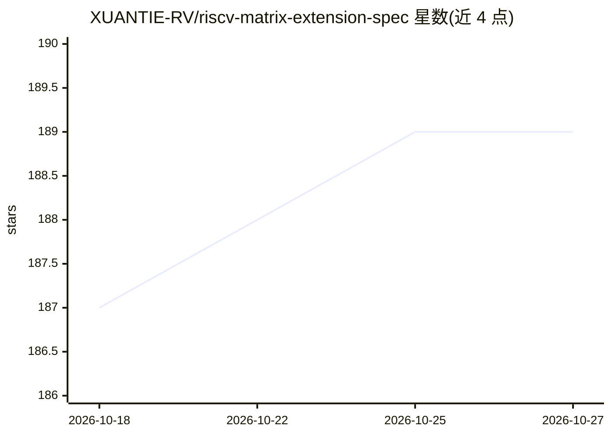

# XUANTIE-RV/riscv-matrix-extension-spec

⭐ 189 · Makefile · Apache-2.0 · 推送 2026-04-01 · [GitHub](https://github.com/XUANTIE-RV/riscv-matrix-extension-spec) · 组织维护 · 中文 README

**RISC-V 架构面向 AI 应用的矩阵扩展指令集规范提案（V0.6.0）**

由 XUANTIE（玄铁/T-HEAD）维护的 RISC-V 矩阵扩展规范提案项目，面向 AI 应用提供矩阵运算指令集定义。V0.6.0 更新包括分离源寄存器与累加寄存器、可调行列数的灵活寄存器形状（覆盖外积到内积）、新增逐元素指令以便利算子融合。仓库含规范文本、SHL 2.0 用户指南与 intrinsic API/ABI 手册，文档经 AsciiDoctor 生成 PDF；另提供基于 QEMU 的性能评估 demo 与工具链构建流程。规范仍在建设中，为预览项目。

## 筛选速览

| 维度 | 判定 | 备注 |
|---|---|---|
| AI 角色 | `ai-knowledge` | 知识聚合/清单类 |
| 许可风险 | `permissive` | Apache-2.0 |
| 部署形态 | `None` |  |
| 模型依赖 | — | README 未给出锁定关系 |
| 硬件要求 | — | 无带数字的原话,不猜 |
| 安装摩擦 | `low` | 无编译、无系统依赖或容器化 |
| 成熟度 | `idea` | |

## 能力要点

- 规范文本与 SHL 2.0 用户指南、intrinsic API/ABI 手册随仓库提供
- V0.6.0：源/累加寄存器分离，寄存器行列数可调，覆盖外积到内积
- 提供二进制 demo 与 QEMU 方式评估矩阵扩展性能
- 文档经 AsciiDoctor 构建，可由 make 生成 PDF

## 适用场景

- 查阅 RISC-V 矩阵扩展的指令集定义与 ABI 约定
- 在 QEMU 模拟环境中评估矩阵扩展的性能表现
- 基于 T-HEAD 工具链编写使用矩阵扩展的算子并编译运行

## 场景标签

 · 领域:芯片架构/指令集规范

## 证据(README 行号)

> L4: This is a matrix extension proposal for AI applications under RISC-V architecture. The extension is currently at ver
> L16: |--spec                     ## The RISC-V Matrix Extension specification

## 星数曲线

2026-10-18 187 → 2026-10-27 189（+2）

---
*卡片 v1 · prompt 1.4 · 生成 2026-10-22 · 置信度 high · 依据 README sha `0b05d3485e38` · [字段定义](../../DATASET.md)*
