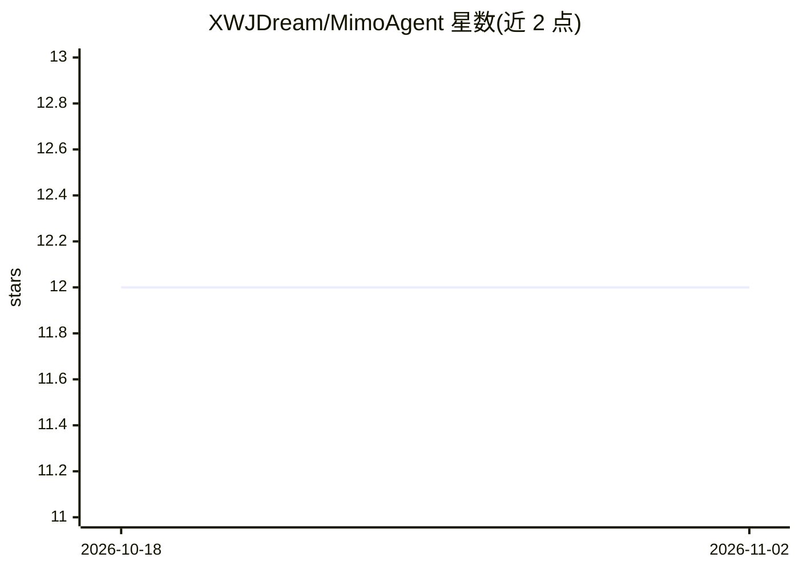

# XWJDream/MimoAgent

⭐ 12 · TypeScript · NOASSERTION · 推送 2026-06-15 · [GitHub](https://github.com/XWJDream/MimoAgent) · 个人维护 · 中文 README

**基于小米 MiMo 大模型的 AI 编程助手桌面端**

Electron 桌面应用，以 MiMo v2.5 Pro 为默认模型的 AI 编程工作台：支持多轮对话、13 种内置工具（文件读写、Shell、Git、Web 抓取、任务管理等）、多 Agent 协同、MCP 插件扩展、TTS 语音合成与 SQLite FTS5 记忆系统。面向普通用户与开发者，Windows 提供安装包，也可克隆源码构建（Node.js>=22）。首次启动需在小米 MiMo 开放平台配置 API Key；内置 MiMo/OpenAI/Anthropic/OpenAI 兼容多 Provider。另含权限控制、沙盒模式与上下文压缩机制。

## 筛选速览

| 维度 | 判定 | 备注 |
|---|---|---|
| AI 角色 | `ai-native` | 本体是模型或模型工具 |
| 许可风险 | `none` | NOASSERTION |
| 部署形态 | `desktop` | 安装包/桌面程序 |
| 模型依赖 | — | README 未给出锁定关系 |
| 硬件要求 | — | 无带数字的原话,不猜 |
| 安装摩擦 | `low` | 无编译、无系统依赖或容器化 |
| 成熟度 | — | 结构信号不足 |

## 能力要点

- 代码生成、调试、重构与项目分析，Agent 自主调用 13 种内置工具
- 多 Provider 支持：MiMo/OpenAI/Anthropic/OpenAI 兼容
- MCP 插件（JSON-RPC 2.0）与本地插件系统（6 种 Hook）
- SQLite FTS5 记忆系统与分层上下文压缩策略

## 适用场景

- 在桌面端通过对话完成编码、调试与重构
- 让 Agent 执行 Git 操作、Shell 命令与网页抓取
- 通过 MCP 与本地插件扩展第三方工具能力

## 场景标签

`编码 Agent` `多智能体` · 领域:Agent 开发

## 证据(README 行号)

> L3: **AI 驱动的智能编程助手桌面端**
> L44: - **AI 对话** — 基于 MiMo v2.5 Pro 模型，支持上下文理解与多轮对话
> L60: - **多 Provider 支持** — 内置 MiMo/OpenAI/Anthropic/OpenAI-兼容，Provider 注册中心

## 星数曲线

2026-10-18 12 → 2026-11-02 12（+0）

---
*卡片 v1 · prompt 1.4 · 生成 2026-11-01 · 置信度 high · 依据 README sha `e8e360529d5a` · [字段定义](../../DATASET.md)*
