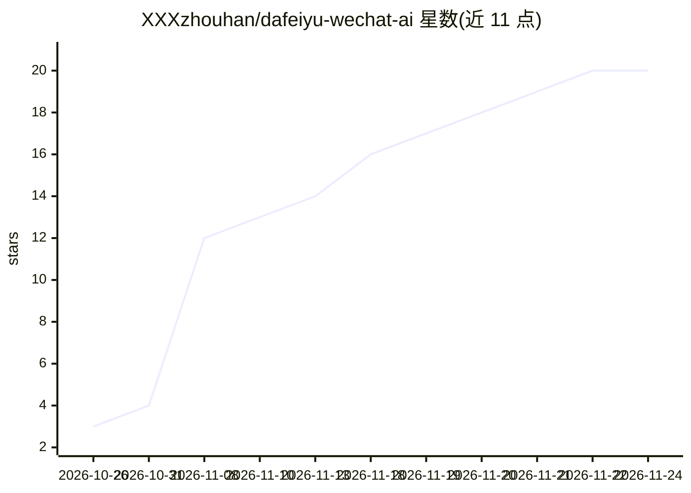

# XXXzhouhan/dafeiyu-wechat-ai

⭐ 20 · Python · MIT · 推送 2026-10-21 · [GitHub](https://github.com/XXXzhouhan/dafeiyu-wechat-ai) · 个人维护 · 中文 README

**在 Windows 微信小号上运行的微信群/私聊 AI 自动回复机器人**

面向个人用户的微信群/私聊 AI 群友机器人：只读解密微信 4.x 本地 SQLCipher 数据库获取新消息，被 @、叫名字或追问时调用 DeepSeek（默认 deepseek-flash，兼容 OpenAI 接口模型）生成回复，再通过 Windows UIA 后台发送回群。支持联网搜索（DeepSeek Search/Fetch API）、图片识别、人设配置、表情包收发、定时抓取热梗注入提示词。运行需 Windows 10/11、微信 4.1.12+、已登录的小号与 API Key；通过写入 Weixin.dll 内存与读取数据库密钥实现，README 声明存在微信风控/封号风险。提供 setup.bat 一键安装与桌面配置 APP。

## 筛选速览

| 维度 | 判定 | 备注 |
|---|---|---|
| AI 角色 | `ai-native` | 本体是模型或模型工具 |
| 许可风险 | `permissive` | MIT |
| 部署形态 | `None` |  |
| 模型依赖 | locked-api |  |
| 硬件要求 | — | 无带数字的原话,不猜 |
| 安装摩擦 | `low` | 无编译、无系统依赖或容器化 |
| 成熟度 | — | 结构信号不足 |

## 能力要点

- 解密只读微信 4.x SQLCipher 数据库读取群消息，UIA 后台发送回复，无需 OCR
- smart 触发模式：@、叫名字、关键词或 120 秒内追问，带插话判断不抢话
- 联网搜索、图片识别、表情包收发与热梗语料定时更新
- 多群与私聊同时监听，每会话独立上下文

## 适用场景

- 让一个微信小号在群里当 AI 群友自动回消息
- 私聊场景一对一自动回复，带更长上下文
- 群里发图让它识别或点评，用表情包互动

## 场景标签

`聊天机器人` · 领域:对话与助手

## 证据(README 行号)

> L3: 在 Windows 上跑一个属于你的微信群 AI 成员：用微信小号登录，读取本地数据库的新消息，被叫到、@ 或接着追问时调用 DeepSeek 回复，再用 UIA 把回复发回群里。
> L12: - **想**：调用 DeepSeek（默认 `deepseek-flash`），人设写在 `persona.txt`
> L14: - **发**：热激活微信的 Qt 无障碍树，用 UIA 把回复发到目标群

## 星数曲线

2026-10-26 3 → 2026-11-24 20（+17）

---
*卡片 v1 · prompt 1.4 · 生成 2026-11-18 · 置信度 high · 依据 README sha `201cd352fd46` · [字段定义](../../DATASET.md)*
