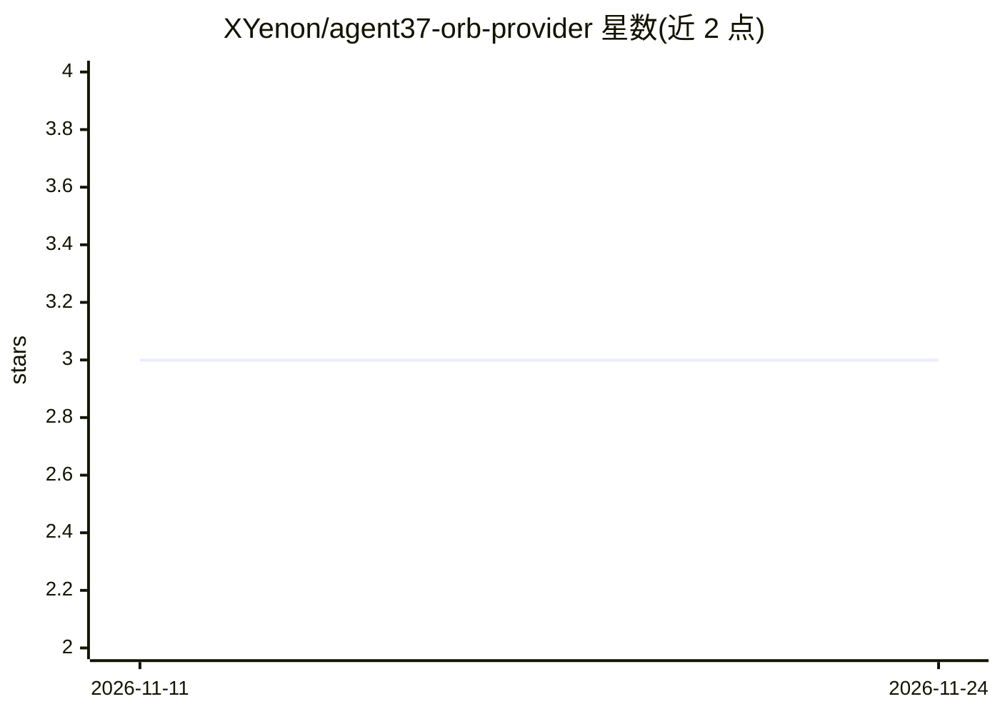

# XYenon/agent37-orb-provider

⭐ 3 · Shell · AGPL-3.0 · 推送 2026-11-22 · [GitHub](https://github.com/XYenon/agent37-orb-provider) · 个人维护

**让 Amp 自托管 orbs 运行在 Agent37 云沙箱上的 Bash 提供者**

实现 Amp 自托管 orb 提供者契约的适配层：以单个 dispatch.sh 脚本将 Amp 的 spawn/pause/delete 任务映射到 Agent37 Sandbox REST API 的实例操作。纯 Bash 实现，仅依赖 curl、jq、flock 与 systemd，无需外部 SDK；提供 16 种预配置规格（Debian/Arch × 容器/VM × 四档尺寸）、systemd 定时器磁盘自动扩容、270 秒执行预算与 409/429 重试机制，支持单命令交互安装与非交互 CI 安装。面向 DevOps/系统管理员与运维人员，需自行提供 Agent37 工作区 API key 与 Amp 提供者 token。

## 筛选速览

| 维度 | 判定 | 备注 |
|---|---|---|
| AI 角色 | `ai-ecosystem` | LLM/agent 周边工具 |
| 许可风险 | `viral` | AGPL-3.0 |
| 部署形态 | `None` |  |
| 模型依赖 | — | README 未给出锁定关系 |
| 硬件要求 | — | 无带数字的原话,不猜 |
| 安装摩擦 | `low` | 无编译、无系统依赖或容器化 |
| 成熟度 | — | 结构信号不足 |

## 能力要点

- 纯 Bash 实现，仅依赖 curl/jq/flock，直接调用 Agent37 Sandbox REST API
- 16 种预配置规格（Debian 或 Arch × 容器或全 VM × S/M/L/XL）
- systemd 定时器监控磁盘占用并自动调用扩容 API
- 270 秒统一执行预算，自动重试 409/429 并唤醒冷存储实例

## 适用场景

- 将 Amp 的自托管 orb 运算迁移到 Agent37 云沙箱
- 为 orb 提供自动磁盘扩容与状态持久化运维
- CI/CD 流水线中非交互式部署 orb 提供者

## 场景标签

 · 领域:AI 开发工具基础设施/云沙箱适配

## 证据(README 行号)

> L7: Run Amp self-hosted orbs seamlessly on Agent37 cloud sandboxes.
> L9: `dispatch.sh` implements Amp's self-hosted orb provider contract on top of Agent37's Sandbox REST API. It gives you 
> L30: - **Zero Heavy Runtimes**: Pure Bash, `curl`, `jq`, and `flock`. Communicates directly with the Agent37 Sandbox RES

## 星数曲线

2026-11-11 3 → 2026-11-24 3（+0）

---
*卡片 v1 · prompt 1.4 · 生成 2026-11-22 · 置信度 high · 依据 README sha `b568a6ef02f0` · [字段定义](../../DATASET.md)*
