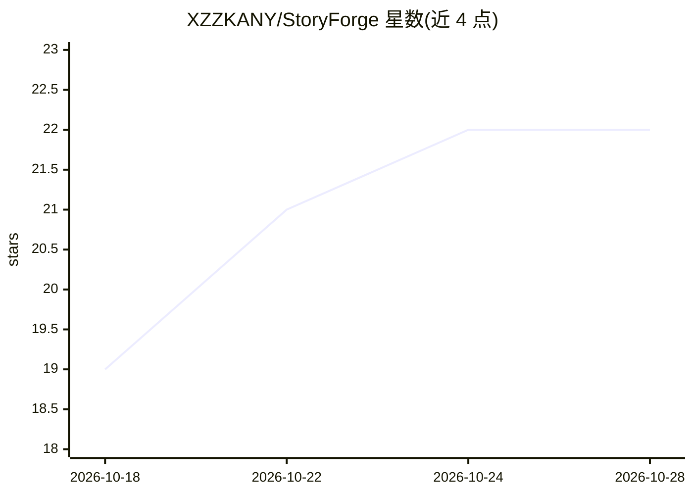

# XZZKANY/StoryForge

⭐ 23 · TypeScript · MIT · 推送 2026-10-28 · [GitHub](https://github.com/XZZKANY/StoryForge) · [官网](https://github.com/XZZKANY/StoryForge/releases/latest) · 个人维护 · 中文 README

**长篇小说作者的 AI 写作 IDE：对话审稿、逐字 diff 确认落盘**

面向长篇小说作者的本地桌面写作工具（Tauri 2 + React + Monaco）。作者打开本地小说文件夹，通过对话式 Agent 审稿、修订、起草：Agent 自主翻目录、读章节、全书检索，所有对正文的修改以逐字对比补丁呈现，「询问」档下需作者确认才写入。配套事实台账、伏笔账、人物实体登记防前后矛盾，另有行间改写/续写（Ctrl+K / Ctrl+Shift+K）、版本快照与撤销、拆书等功能。自带模型 key 直连服务商，纯本地无服务端；目前仅提供 Windows 安装包，处于作者自用打磨阶段。

## 筛选速览

| 维度 | 判定 | 备注 |
|---|---|---|
| AI 角色 | `ai-native` | 本体是模型或模型工具 |
| 许可风险 | `permissive` | MIT |
| 部署形态 | `library` | 以包/库形式分发 |
| 模型依赖 | local-ok | 支持本地模型 |
| 硬件要求 | — | 无带数字的原话,不猜 |
| 安装摩擦 | `low` | 无编译、无系统依赖或容器化 |
| 成熟度 | `idea` | |

## 能力要点

- 对话式 Agent 自主查全书，修改以逐字 diff 补丁呈现，默认需作者确认才写入
- 事实台账、伏笔账、人物实体登记，检测跨章前后矛盾
- 写前快照 + 影子 git 仓库版本记录，一键撤销
- 纯本地运行，API key 用 Windows DPAPI 加密存储

## 适用场景

- 长篇连载写作中审稿、改稿、起草章节初稿
- 检查几十万字作品的人物设定与伏笔前后一致性
- 希望 AI 辅助但保留每处改动的最终决定权
- 用 Ollama 本地模型零 API 费用地写作

## 场景标签

`AI 写作` · 领域:内容生成

## 证据(README 行号)

> L5: **长篇小说作者的 AI 写作 IDE**
> L7: 在本地打开你的小说项目，和会自己翻查全书的 Agent 一起审稿、改稿、起草。
> L30: - **你是作者，AI 是编辑和助手。** 它读稿、挑问题、提改法、起草初稿；正文怎么写，默认由你拍板，「询问」档下每个补丁都要你点接受。

## 星数曲线

2026-10-18 19 → 2026-10-28 22（+3）

---
*卡片 v1 · prompt 1.4 · 生成 2026-10-27 · 置信度 mid · 依据 README sha `7d8f185bc371` · [字段定义](../../DATASET.md)*
