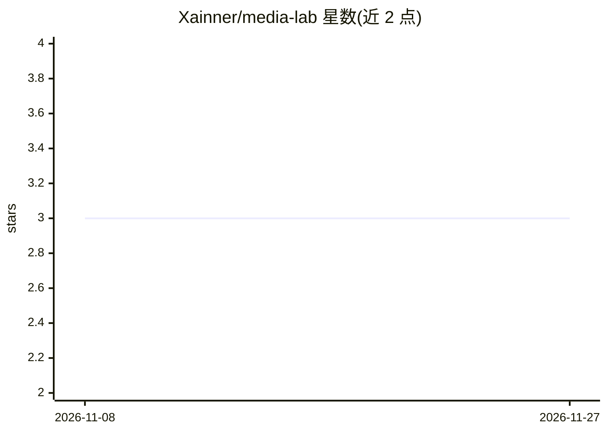

# Xainner/media-lab

⭐ 3 · Python · AGPL-3.0 · 推送 2026-11-12 · [GitHub](https://github.com/Xainner/media-lab) · 个人维护

**自托管的生成式媒体工作室：图像、视频、音乐、语音与 Agent**

Media Lab 是一个自托管的生成式媒体工作室，通过单一 Web 应用将多个开放模型接入统一的提示框，支持文生图、图像编辑、带音频的视频、完整歌曲、音效与文本转语音，全部在本机 GPU 上经 ComfyUI worker 运行，数据不发送到云端生成器。提供 Agent 编排整个制作流程，并通过 MCP 服务器（59 个工具）将工作室暴露给 Claude 等 MCP 客户端。内置私有账户、TOTP 两步验证与按账户配额；模型权重按固定版本下载并做 SHA-256 校验，多数模型许可为非商业或研究用途。

## 筛选速览

| 维度 | 判定 | 备注 |
|---|---|---|
| AI 角色 | `ai-native` | 本体是模型或模型工具 |
| 许可风险 | `dual` | AGPL-3.0 |
| 部署形态 | `self-host` | docker 或自建部署 |
| 模型依赖 | — | README 未给出锁定关系 |
| 硬件要求 | — | 无带数字的原话,不猜 |
| 安装摩擦 | `low` | 无编译、无系统依赖或容器化 |
| 成熟度 | — | 结构信号不足 |

## 能力要点

- 单一 Web 应用整合图像、视频、音频、语音生成与编辑，全部在本机 GPU 运行
- Agent 可规划并产出完整请求，MCP 服务器提供 59 个工具供外部客户端调用
- 模型按固定版本下载并以 SHA-256 校验，提供 minimal/recommended/all 三种安装预设
- 账户体系含 TOTP 两步验证、邀请制与按账户配额，UI 支持英语与西班牙语

## 适用场景

- 在自己的 GPU 上搭建私人图像、视频与音乐生成工作室
- 通过 MCP 客户端（如 Claude Code）以工具调用方式驱动媒体生成
- 从一首歌自动生成带分镜与关键帧的音乐视频
- 小圈子内以邀请制账户共享生成能力并控制配额

## 场景标签

`图像生成` `语音合成` `视频生成` · 领域:内容生成

## 证据(README 行号)

> L22: **Media Lab** is a self-hosted studio for generative media. One web app puts today's best open
> L25: effects, and text-to-speech. Everything runs on your own GPUs through
> L133: Turn on **AI** in the creator, or open the agent, and describe the result you want. The agent

## 星数曲线

2026-11-08 3 → 2026-11-27 3（+0）

---
*卡片 v1 · prompt 1.4 · 生成 2026-11-26 · 置信度 mid · 依据 README sha `06287c5cf05c` · [字段定义](../../DATASET.md)*
