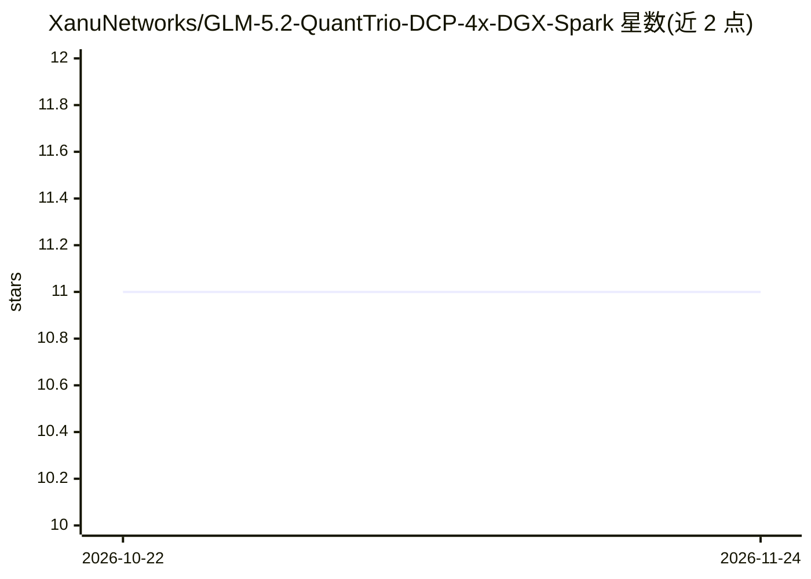

# XanuNetworks/GLM-5.2-QuantTrio-DCP-4x-DGX-Spark

⭐ 11 · Shell · Apache-2.0 · 推送 2026-07-19 · [GitHub](https://github.com/XanuNetworks/GLM-5.2-QuantTrio-DCP-4x-DGX-Spark) · [官网](https://www.xanu.com) · 个人维护

**在 4×DGX Spark 集群部署 GLM-5.2 量化模型的复现配方**

一份可复现的部署配方仓库：在四台 GB10 DGX Spark 节点上以 TP4 + DCP + MTP 投机解码运行未剪枝的 GLM-5.2 QuantTrio Int4-Int8Mix 量化模型，提供四条配置通道（GLM_LANE 切换）：327K 深度、655K 最大上下文、以及 3×200K / 5×128K 多用户并发。包含 vLLM fork 构建、权重下载与分发脚本、启动脚本、GPU 时钟预检、RoCE 网络配置与排障文档。面向拥有 DGX Spark 集群并需本地自托管大模型的用户。

## 筛选速览

| 维度 | 判定 | 备注 |
|---|---|---|
| AI 角色 | `ai-ecosystem` | LLM/agent 周边工具 |
| 许可风险 | `permissive` | Apache-2.0 |
| 部署形态 | `self-host` | docker 或自建部署 |
| 模型依赖 | local-ok | 支持本地模型 |
| 硬件要求 | — | 无带数字的原话,不猜 |
| 安装摩擦 | `low` | 无编译、无系统依赖或容器化 |
| 成熟度 | — | 结构信号不足 |

## 能力要点

- 一条配方覆盖四条通道：最大深度、655K 最大上下文、3 或 5 路多用户并发
- 基于 TP4 + DCP + MTP 投机解码与 fp8 sparse-MLA KV
- 附带 GPU 时钟健康预检与 RoCE 织网自动配置等运维工具
- 提供 tool-calling 与解码吞吐的基准数据及复现命令

## 适用场景

- 在 DGX Spark 集群上自托管 GLM-5.2 获得超长上下文
- 为多个并发 agent 提供本地推理服务
- 复现并调优社区 DCP 推理配方

## 场景标签

`推理引擎` `模型量化` · 领域:训练与推理

## 证据(README 行号)

> L3: **Serve the unpruned GLM-5.2 (QuantTrio Int4-Int8Mix, all 256 experts) across four GB10 Sparks — one recipe, four la
> L68: - **vLLM:** `local-inference-lab/vllm`
> L114: `scripts/glm-node-launch.sh` (adapted from tonyd2wild's launcher, itself from

## 星数曲线

2026-10-22 11 → 2026-11-24 11（+0）

---
*卡片 v1 · prompt 1.4 · 生成 2026-11-18 · 置信度 mid · 依据 README sha `b707ad30d5b7` · [字段定义](../../DATASET.md)*
