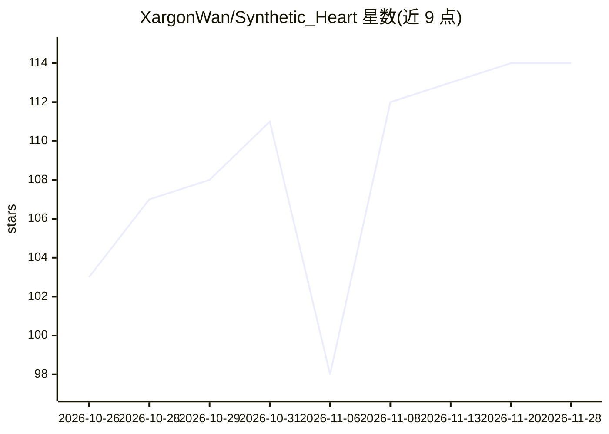

# XargonWan/Synthetic_Heart

⭐ 114 · Python · NOASSERTION · 推送 2026-11-26 · [GitHub](https://github.com/XargonWan/Synthetic_Heart) · [官网](https://synthetic-heart.readthedocs.io) · 个人维护

**面向终端用户的持久化 AI 人格/数字陪伴应用**

开源（FOSS）应用与框架，用于创建一个可跨 Discord、Telegram、Matrix、WebUI 等接口持续存在的 AI 人格（Synth），其身份、记忆与性格存储在数据库而非单次会话中。关键机制：可热切换的引擎后端（云端 API 或自托管）、双向 OpenAI 兼容 API 服务器（端口 11435）、Vox/Auris/Iris 语音与视觉子系统、插件系统、G.R.I.L.L.O. 自主内省循环，以及带 VRM 头像的 Web UI。支持通过插件开关关闭情感子系统，README 称其处于 Beta 状态。

## 筛选速览

| 维度 | 判定 | 备注 |
|---|---|---|
| AI 角色 | `ai-native` | 本体是模型或模型工具 |
| 许可风险 | `none` | NOASSERTION |
| 部署形态 | `desktop` | 安装包/桌面程序 |
| 模型依赖 | local-ok | 支持本地模型 |
| 硬件要求 | — | 无带数字的原话,不猜 |
| 安装摩擦 | `low` | 无编译、无系统依赖或容器化 |
| 成熟度 | `idea` | |

## 能力要点

- 双向 OpenAI 兼容：可暴露为 API 端点，也可由任意 OpenAI 兼容后端驱动
- 数据库持久化的记忆、情感与自我成长状态（SOUL / G.R.I.L.L.O.）
- Agentic 运行时：工具调用、MCP 双向支持、Drones 子代理
- Vox 语音合成、Auris 语音识别、Iris 视觉三个可热插拔媒体子系统

## 适用场景

- 在 Discord/Telegram 等平台养一个跨接口持续记忆的 AI 伙伴
- 用自托管模型驱动自己的数字人格并掌控数据
- 给 AI 人格接上语音对话、语音消息理解与图像识别能力
- 通过插件与 MCP 扩展人格能执行的动作

## 场景标签

`聊天机器人` · 领域:对话与助手

## 证据(README 行号)

> L15: Synthetic Heart (SyntH) is a FOSS application and framework that helps you create and meet a persistent AI persona,
> L80: Synthetic Heart speaks the OpenAI protocol in **both directions**. Inbound, it exposes an OpenAI-compatible API ser
> L91: SyntH can act as an agent, calling *tools* — native actions and remote MCP tools — inside a bounded reasoning loop.

## 星数曲线

2026-10-26 103 → 2026-11-28 114（+11）

---
*卡片 v1 · prompt 1.4 · 生成 2026-11-28 · 置信度 high · 依据 README sha `74a2df44fecc` · [字段定义](../../DATASET.md)*
