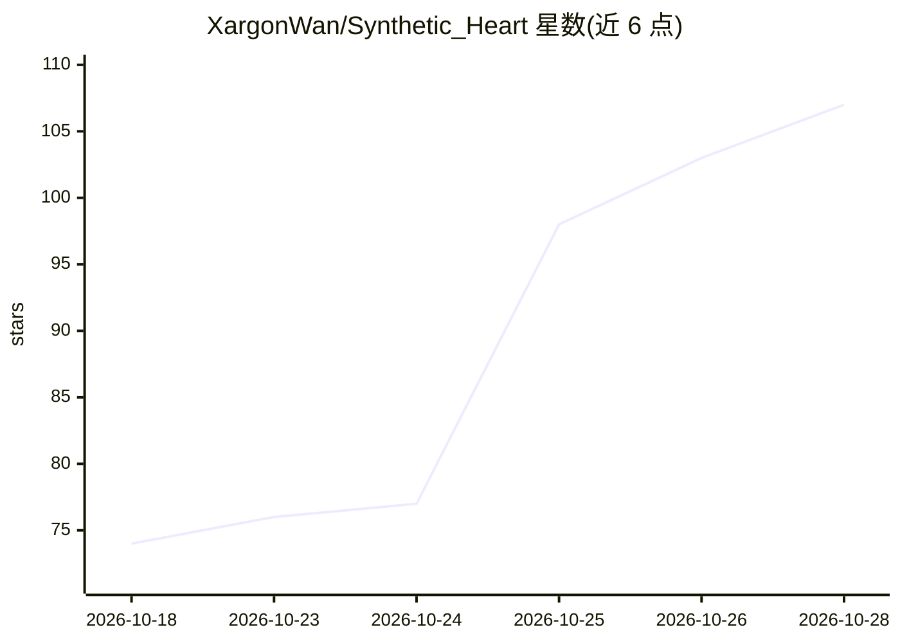

# XargonWan/Synthetic_Heart

⭐ 108 · Python · NOASSERTION · 推送 2026-10-20 · [GitHub](https://github.com/XargonWan/Synthetic_Heart) · [官网](https://synthetic-heart.readthedocs.io) · 个人维护

**让用户创建跨平台持久 AI 人格（Synth）的开源框架与应用**

FOSS 应用与框架，用于创建并会面持久化 AI 人格“Synth”：其身份、记忆与人格存于数据库而非单次 LLM 会话，可跨 Discord、Telegram、Matrix 与 WebUI 保持连续性。引擎支持 Gemini、OpenAI、Claude、Grok 及本地 OpenAI 兼容实例，运行时可热切换；入站暴露 OpenAI 兼容 API 服务器（端口 11435，兼容旧版 Ollama 方言），出站提供多种渲染器。包含 TTS/STT/视觉三个媒体子系统、带工具调用与 MCP 双向支持的 Agent 运行时、VRM 虚拟形象 WebUI、情感与长期记忆、G.R.I.L.L.O. 自主反思系统及插件机制。状态为 Beta，声明可供日常使用。面向中国用户的合规说明提供情感子系统关闭开关。

## 筛选速览

| 维度 | 判定 | 备注 |
|---|---|---|
| AI 角色 | `ai-native` | 本体是模型或模型工具 |
| 许可风险 | `none` | NOASSERTION |
| 部署形态 | `desktop` | 安装包/桌面程序 |
| 模型依赖 | local-ok | 支持本地模型 |
| 硬件要求 | — | 无带数字的原话,不猜 |
| 安装摩擦 | `low` | 无编译、无系统依赖或容器化 |
| 成熟度 | `idea` | |

## 能力要点

- 引擎热切换：Gemini/OpenAI/Claude/Grok 或本地 OpenAI 兼容实例
- 双向 OpenAI 协议：入站 OpenAI 兼容 API 服务器（含 Ollama 方言），出站多引擎渲染器
- Agent 运行时：沙箱文件/shell 工具、Drone 子代理、MCP 双向支持
- VRM 3D 虚拟形象（口型同步、表情、眨眼）与持久情感/长期记忆

## 适用场景

- 创建一个跟随自己在 Discord/Telegram/WebUI 各平台的持久 AI 伙伴
- 把自己的 Synth 作为 OpenAI 兼容端点接入任何支持 AI 的应用
- 通过插件与 MCP 工具扩展 Synth 的能力
- 作为带语音、视觉与虚拟形象的 AI 人格自托管部署

## 场景标签

`Agent 记忆` `聊天机器人` · 领域:Agent 开发

## 证据(README 行号)

> L13: Synthetic Heart (SyntH) is a FOSS application and framework that helps you create and meet a persistent AI persona,
> L71: API-driven Gemini, OpenAI, Claude, Grok, or local OpenAI-compatible instances: hot-swappable at runtime.

## 星数曲线

2026-10-18 74 → 2026-10-28 107（+33）

---
*卡片 v1 · prompt 1.4 · 生成 2026-10-24 · 置信度 mid · 依据 README sha `59c262e10505` · [字段定义](../../DATASET.md)*
