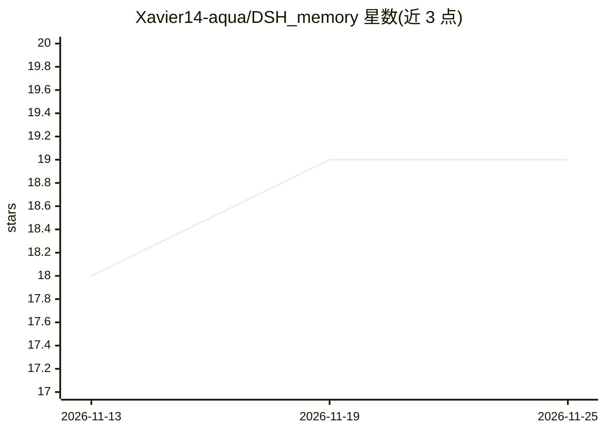

# Xavier14-aqua/DSH_memory

⭐ 19 · JavaScript · MIT · 推送 2026-11-12 · [GitHub](https://github.com/Xavier14-aqua/DSH_memory) · 个人维护 · 中文 README

**为 DeepSeek Harness/QQbridge 提供长期记忆的本地插件与 worker**

运行于 DeepSeek Harness（DSH）内部的记忆插件，附带独立 worker 进程：插件提供按需只读的 memory_context 检索工具，worker 将近期 QQ 聊天整理为群时间线、成员事实与动态人设。机制包括按会话作用域隔离、pending 队列、30/100 条批处理与 12 小时兜底、事务写入与整批回滚、近重复去重；读取 QQbridge sessions.json 复核会话绑定，文件缺失时失败关闭。已验证环境限于 Windows 10/11、Node.js>=22.13.0、QQbridge 0.2.1-r2、DSH Desktop 0.2.2-rc.1，无运行时 npm 依赖。

## 筛选速览

| 维度 | 判定 | 备注 |
|---|---|---|
| AI 角色 | `ai-ecosystem` | LLM/agent 周边工具 |
| 许可风险 | `permissive` | MIT |
| 部署形态 | `None` |  |
| 模型依赖 | locked-api |  |
| 硬件要求 | — | 无带数字的原话,不猜 |
| 安装摩擦 | `low` | 无编译、无系统依赖或容器化 |
| 成熟度 | — | 结构信号不足 |

## 能力要点

- 按需只读 memory_context 工具，先过滤后检索，按会话作用域隔离
- 独立 worker 整理群时间线、成员事实与动态人设，含 pending 队列与批处理兜底
- JSON Schema 补丁、事务写入、审计、整批回滚与近重复去重
- 提供 DSH 安装/卸载、诊断（doctor）、离线测试（基线 106/106）

## 适用场景

- 让 QQ 上的 DSH agent 记住群成员事实、群规与历史事件
- 私聊与群聊按会话隔离检索长期记忆，避免整库注入
- 对已部署的 QQbridge+DSH 链路做记忆整理与审计

## 场景标签

`Agent 记忆` · 领域:Agent 开发

## 证据(README 行号)

> L3: 面向 QQbridge + DeepSeek Harness（DSH）的本地长期记忆插件。它提供一个按需只读的
> L4: `memory_context` 工具，并用独立 worker 将近期聊天整理为群时间线、成员事实和动态人设。
> L23:                            │          └─ memory_context（本插件，只读检索）

## 星数曲线

2026-11-13 18 → 2026-11-25 19（+1）

---
*卡片 v1 · prompt 1.4 · 生成 2026-11-18 · 置信度 high · 依据 README sha `e596aee3353f` · [字段定义](../../DATASET.md)*
