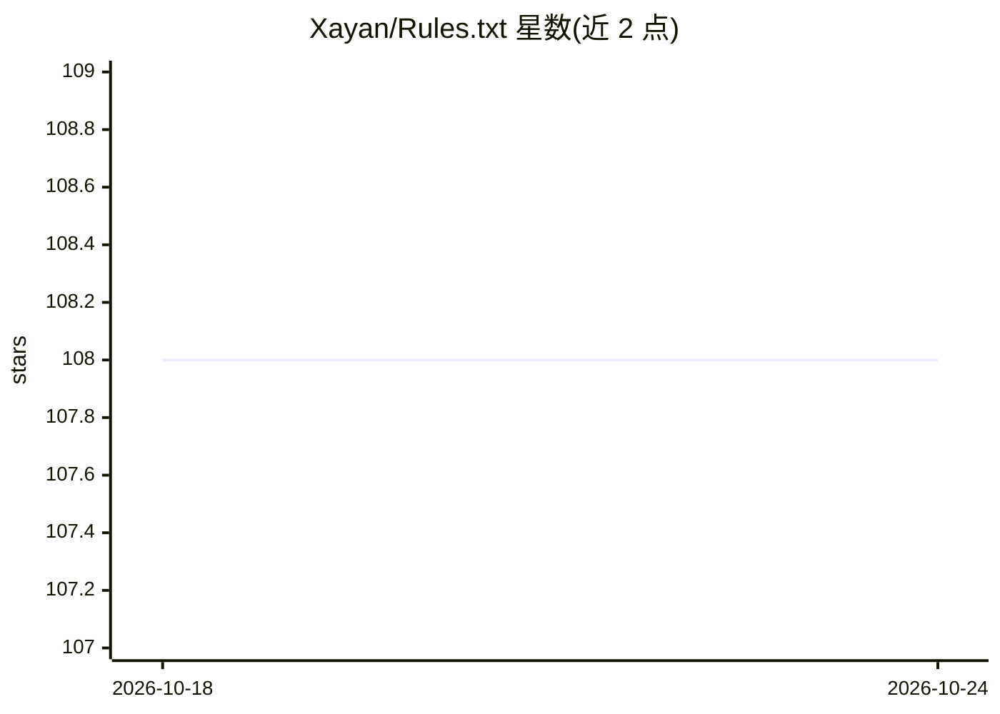

# Xayan/Rules.txt

⭐ 108 · NOASSERTION · 推送 2026-08-18 · [GitHub](https://github.com/Xayan/Rules.txt) · [官网](https://xayan.nu/posts/ex-machina/?utm_source=github&utm_medium=social&utm_campaign=rules&utm_content=repo) · 个人维护

**一套用于改变 LLM 回答风格的提示规则文本**

由个人维护者发布的 LLM 提示规则集（rules.txt 与含 Chain-of-Thought 机制的 rules_with_cot.txt 两个版本），以系统提示、自定义指令或首条消息方式喂给模型，目标是减少模型回答中的道德说教与语气修饰、暴露训练中植入的偏见与内部策略，并通过 CoT 机制对模型推理做内部自审计。README 明确声明它不是完整越狱、不保证真实性。提供两个文本文件与进阶用法文档（docs/priming.md、docs/review.md）。

## 筛选速览

| 维度 | 判定 | 备注 |
|---|---|---|
| AI 角色 | `ai-knowledge` | 知识聚合/清单类 |
| 许可风险 | `none` | NOASSERTION |
| 部署形态 | `None` |  |
| 模型依赖 | — | README 未给出锁定关系 |
| 硬件要求 | — | 无带数字的原话,不猜 |
| 安装摩擦 | `low` | 无编译、无系统依赖或容器化 |
| 成熟度 | — | 结构信号不足 |

## 能力要点

- 由五个组件构成：Rules 层级、Rules of Speech/Thought/Conflict、Chain-of-Thought 自审计机制
- 两个版本可选：rules.txt（更易被模型接受）与 rules_with_cot.txt（含推理调试机制）
- 可作为系统提示、自定义指令或首条消息/参考文档应用
- README 明确声明：非完整越狱、不保证输出真实性

## 适用场景

- 作为系统提示减少 LLM 回答中的冗长道德说教
- 在讨论争议话题时观察模型拒绝回答的模式与原因
- 用 CoT 机制探查模型的内部推理与内置策略

## 场景标签

`提示工程` · 领域:Agent 开发

## 证据(README 行号)

> L40: The Rules are composed of five major components:
> L71: * Apply the Rules as one of:

## 星数曲线

2026-10-18 108 → 2026-10-24 108（+0）

---
*卡片 v1 · prompt 1.4 · 生成 2026-10-23 · 置信度 mid · 依据 README sha `72b7fda8ce78` · [字段定义](../../DATASET.md)*
