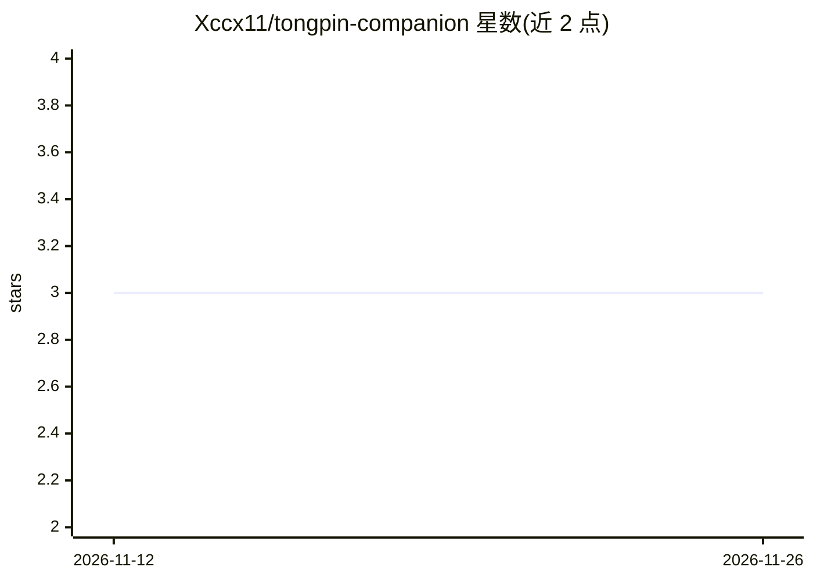

# Xccx11/tongpin-companion

⭐ 3 · PowerShell · AGPL-3.0 · 推送 2026-11-11 · [GitHub](https://github.com/Xccx11/tongpin-companion) · 个人维护 · 中文 README

**本地优先的 Android AI 伴侣 App：聊天、主动联系与场景照片**

Android 平台（Kotlin + Jetpack Compose）的 AI 伴侣客户端：角色具备作息、心情与位置设定，可主动发消息与照片；对话经用户自建的 OpenAI 兼容本地 AI 网关转发到对话模型与生图后端，生成场景照片的提示词由对话内容产生。模型、提示词规则、图片后端均在运行时配置，仓库不含模型权重，需自行部署网关并确认模型内容合规。工程侧提供请求追踪、离线幂等队列与 39 个行为测试。

## 筛选速览

| 维度 | 判定 | 备注 |
|---|---|---|
| AI 角色 | `ai-native` | 本体是模型或模型工具 |
| 许可风险 | `viral` | AGPL-3.0 |
| 部署形态 | `None` |  |
| 模型依赖 | — | README 未给出锁定关系 |
| 硬件要求 | — | 无带数字的原话,不猜 |
| 安装摩擦 | `low` | 无编译、无系统依赖或容器化 |
| 成熟度 | — | 结构信号不足 |

## 能力要点

- 本地优先：对话与推理走自建 OpenAI 兼容服务，数据留在本地
- 角色有作息、心情与位置，可主动发消息与照片
- 对话内容生成画面提示词，交由本地/自建生图服务出图
- 模型、提示词规则、图片后端运行时可配置

## 适用场景

- 在 Android 手机上运行一个有生活节奏的 AI 伴侣
- 用自己的本地模型跑聊天与生图，数据不出本机
- 按对话内容自动生成场景照片

## 场景标签

`聊天机器人` `图像生成` · 领域:对话与助手

## 证据(README 行号)

> L17: 一个本地优先的 AI 伴侣 App（Android，Kotlin + Jetpack Compose），把「聊天 / 生活状态 / 主动联系 / 场景照片」串成一条连续的体验。
> L21: - **本地优先**：对话与推理走你自建的服务（OpenAI 兼容），数据留在你自己机器上。
> L30: - 服务端：本项目只包含 App；配套的本地 AI 网关（OpenAI 兼容，转发到对话模型与生图后端）需自行部署。

## 星数曲线

2026-11-12 3 → 2026-11-26 3（+0）

---
*卡片 v1 · prompt 1.4 · 生成 2026-11-22 · 置信度 high · 依据 README sha `823e61e48e69` · [字段定义](../../DATASET.md)*
