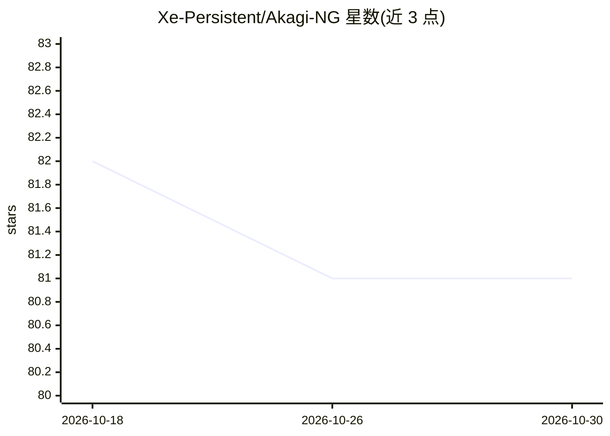

# Xe-Persistent/Akagi-NG

⭐ 81 · TypeScript · AGPL-3.0 · 推送 2026-10-26 · [GitHub](https://github.com/Xe-Persistent/Akagi-NG) · 组织维护 · 中文 README

**日本麻将 AI 助手：为雀魂对局提供实时分析与切牌建议**

面向日本立直麻将在线游戏（雀魂）的 Electron 桌面 AI 助手，原 Akagi 项目的重写版。内置 4 人/3 人 Akagi 模型，由 Rust 原生推理引擎驱动，提供实时手牌分析、切牌与立直后决策建议，以及吃碰杠行动提示。通过内置浏览器模式（默认）或 MITM 代理模式（含 CA 证书与 127.0.0.1:6789 代理）获取对局数据，支持 Windows/macOS(Apple Silicon)/Linux。README 声明仅供教育研究用途，且不支持自动对局；使用第三方辅助工具可能违反游戏服务条款。

## 筛选速览

| 维度 | 判定 | 备注 |
|---|---|---|
| AI 角色 | `ai-native` | 本体是模型或模型工具 |
| 许可风险 | `viral` | AGPL-3.0 |
| 部署形态 | `desktop` | 安装包/桌面程序 |
| 模型依赖 | — | README 未给出锁定关系 |
| 硬件要求 | — | 无带数字的原话,不猜 |
| 安装摩擦 | `low` | 无编译、无系统依赖或容器化 |
| 成熟度 | — | 结构信号不足 |

## 能力要点

- 内置 Akagi 4p/3p 模型与 Rust 原生推理引擎，无需 libriichi
- 默认内置浏览器模式零配置，另支持 MITM 代理模式覆盖外部浏览器/客户端/移动设备
- 半透明 HUD 直接叠加在游戏画面上显示辅助信息
- 支持标准四人/三人立直与修罗之战模式，四语界面

## 适用场景

- 在雀魂对局中获得实时切牌与行动建议
- 立直后获取最优切牌推荐
- 查看吃碰杠等行动提示与局势分析

## 场景标签

 · 领域:游戏辅助工具

## 证据(README 行号)

> L34: It is an AI-powered assistant designed for Japanese Mahjong (Riichi Mahjong), aimed at providing real-time situatio
> L57:  - Real-time hand analysis and AI discard recommendations
> L63: - 🤖 **AI Models**

## 星数曲线

2026-10-18 82 → 2026-10-30 81（-1）

---
*卡片 v1 · prompt 1.4 · 生成 2026-10-24 · 置信度 high · 依据 README sha `a70a92eb9cf1` · [字段定义](../../DATASET.md)*
