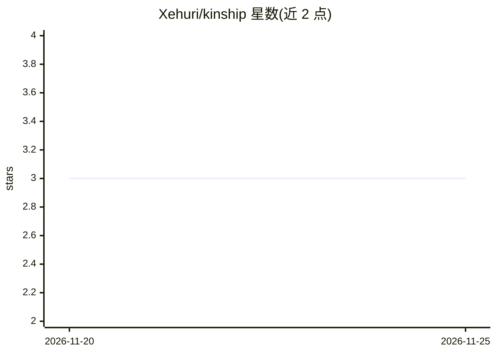

# Xehuri/kinship

⭐ 3 · TypeScript · AGPL-3.0 · 推送 2026-11-17 · [GitHub](https://github.com/Xehuri/kinship) · 个人维护 · 中文 README

**自托管 AI 个人数据助理：采集生活传感器数据并长期分析复盘**

由 Android App/PC 采集器持续采集手机与手环传感器数据（心率、步数、GPS、环境音频、通知等），上传到自托管 FastAPI 后端；Loom AI 助手按定时调度（数据检查、每日复盘、周报）对生活流数据做理解、复盘与提醒。关键机制包括文件即接口（perception.jsonl、Markdown 日报）、三层工作流（脚本确定性预处理→子智能体→主智能体）、记忆协议与上下文 diff 注入。音频 ASR/VAD/声纹由独立闭源内核负责，后端零 ML；AI 运行时依赖外部 Stratum CLI，旧索引格式已弃用并需一次性迁移。

## 筛选速览

| 维度 | 判定 | 备注 |
|---|---|---|
| AI 角色 | `ai-native` | 本体是模型或模型工具 |
| 许可风险 | `viral` | AGPL-3.0 |
| 部署形态 | `library` | 以包/库形式分发 |
| 模型依赖 | local-ok | 支持本地模型 |
| 硬件要求 | — | 无带数字的原话,不猜 |
| 安装摩擦 | `low` | 无编译、无系统依赖或容器化 |
| 成熟度 | `idea` | |

## 能力要点

- Android + 手环多源传感器采集，数据全部落在自有服务器
- 三层工作流与记忆协议，事实与判断分离、结果可追溯
- 音频内核独立部署，ASR/VAD/声纹不上传外部服务
- 支持接入本地 vLLM 或兼容 OpenAI 的 API，模型可替换

## 适用场景

- 自己维护服务器、在意数据主权的个人生活记录
- 让 AI 按定时节拍自动生成每日复盘与健康清单
- 环境音频的本地化识别与深度分析（可选旁路）

## 场景标签

`AI 助手` · 领域:对话与助手

## 证据(README 行号)

> L9: 自托管的 AI 个人数据助理。Android App 持续采集手机和手环传感器数据（心率、步数、GPS、环境音频、通知、屏幕状态等），上传到私有后端；Loom AI（默认，完整工作流）定时分析并生成理解、复盘、健康清单与通知。系统全
> L32: 6. **全栈自托管，模型可替换。** Android、FastAPI、Vue/Electron、PC 采集器和音频内核组成完整链路；可以接本地 vLLM，也可以接兼容 OpenAI 的 API。

## 星数曲线

2026-11-20 3 → 2026-11-25 3（+0）

---
*卡片 v1 · prompt 1.4 · 生成 2026-11-22 · 置信度 high · 依据 README sha `f0ff9453ad45` · [字段定义](../../DATASET.md)*
